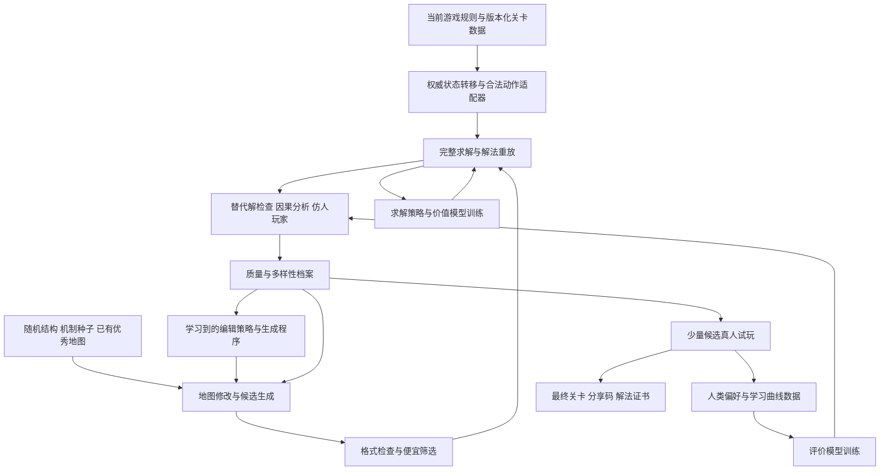

# 鬼迷宫：以精妙解谜为目标的地图生成 AI 调研报告

> 2026-10-11：本文保留原阶段方案／研究背景，训练尚未开始。当前规则、分享、编辑器和回放升级已经完成，以[交付记录](architecture-delivery-20261011.md)和[当前分享协议](share-codes.md)为准；旧体力、旧码及旧独立回放描述不能作为当前使用入口。

日期：2026-09-21。代码基线：`9825376f2cf93f844146c83214f680425c22498b`。

本报告围绕一个明确目标：在个人工作站或少量租用 GPU 的条件下，允许长时间训练、允许长时间生成一张地图，优先追求死亡循环模式中的智力挑战、顿悟与最终流畅通关。探索模式中的紧张、未知与追逐是次要评价维度。

证据分为三类：**代码事实**来自当前实现与本次规则实验；**研究证据**来自所链接的原始论文和作者资料；**方案建议**是针对本游戏提出的设计，尚未经过训练或真人实验验证。报告中的训练规模、预算分配和阶段目标均为起始实验方案，不是已测得的效果或承诺。

阅读建议：第 1～4 节讨论游戏和设计方向；第 5 节比较研究；第 6～14 节给出训练与生成方案；第 15～18 节讨论真人验证、实施和本次证据。

## 1. 核心判断

值得做，而且现有机制已经具备产生好谜题的基础。最有潜力的方向是：**让玩家借助可预测的追逐规则，主动布置鬼的位置，控制通路与视线，最后执行一条理解之后很简洁的解法。**

建议开发一套会逐步学习的离线设计系统：

> 精确规则模拟 → 搜索并验证解法 → 产生和修改候选地图 → 保留不同机制的优秀设计 → 真人判断精妙与公平 → 训练模型提高下一轮搜索质量。

其中需要学习的能力有三个：求解器学习怎样更快找到解；评价器学习什么设计值得玩家喜欢；生成器学习哪些修改更可能带来优秀的新谜题。搜索与验证贯穿训练和最终出图过程。

你的“可以很慢”是一个重要优势。系统可以先找到数百个可解候选，再对少量候选花数小时甚至数天检查替代解、消除冗余、测试认知误导和收集反馈。因而，没有必要把最终质量寄托于模型一次前向推理就输出完美地图。

但有一个上限必须说清：**更多计算能扩大搜索，不能自动让错误的评价标准变成正确的审美。**如果只奖励通关难度，系统可能制造乏味的试错；如果只奖励短解，可能制造简单的直线走廊；如果只奖励陌生结构，可能制造无法理解的混乱。最难的研究问题是学会辨别“需要一个好想法”和“只是难”。

“人类没想到”可以设为探索方向，但不能作为当前可保证的结果。可操作的目标是：发现种子关卡、已有模板和既有解题概念都未覆盖的因果组合，经过独立求解和真人盲评后仍被认为精妙。无法证明全人类从未想过某种设计。

## 2. 当前代码实际定义了怎样的游戏

### 2.1 核心是动作驱动的确定性规划

游戏画面实时刷新，但鬼的物理状态由成功动作推进。停下来思考不会让鬼继续走，也没有独立运行的巡逻计时器。持续按键和自动移动带来的压迫感，来自连续提交动作。视觉轨迹中的 `Date.now()` 不影响追逐结果。

因此，死亡循环特别适合做可分析、可重放的时序谜题。研究环境可以直接调用纯逻辑，而不必让 AI 从截图学习按钮操作或从零学习物理规律。相关入口见 [gameLogic.js:86](D:/Code/Program/Projects/ghost-maze/src/core/gameLogic.js:86) 与 [main.js:334](D:/Code/Program/Projects/ghost-maze/src/main.js:334)。

### 2.2 对训练最重要的规则表

| 机制 | 当前实际行为 | 对谜题与训练的意义 |
| --- | --- | --- |
| 四方向移动 | 移动一格；失败动作返回原状态 | 撞墙不能当作让鬼走一步的等待动作 |
| 正常移动、上下楼 | 增加步数；死亡循环中消耗 1 体力 | 体力约束的是移动及上下楼次数 |
| 按按钮 | 不移动、不增加步数、不耗体力；成功切门后仍推进鬼 | 总动作数与界面步数必须分开记录 |
| 普通门 DOOR | 玩家可通过，鬼不能通过，视线被阻断 | 它是玩家专属通道与避难边界，绝非只有装饰作用 |
| 玻璃 GLASS | 双方不能通过，双方能透过看见 | 可以从安全侧触发追逐；鬼是否移动还取决于有无绕行路径 |
| 数字门 LOCKED | 钥匙数量达标即可穿过，不扣钥匙；门的动态状态变为空 | 钥匙是累积资格；开门同时可能释放鬼的移动与视野 |
| 单向门 ONE_WAY | 玩家只能按箭头方向通过；鬼不能通过；阻断视线 | 支持单向承诺、返回路线与玩家专属绕行 |
| 字母门 LETTER_DOOR | 同字母的门跨层一起翻转，各门可有不同初态 | 可以构造互补通路；同字母门不是彼此独立的开关变量 |
| 打开的字母门 | 玩家与鬼均可通过，也均可透视 | 机关改变的是双方通路和视线 |
| 鬼的触发 | 只在同行或同列且视线允许时追逐 | 可以围绕暴露、遮断与目标方向进行推理 |
| 鬼失去视线 | 若本次计算中能看到玩家动作前的位置，则朝该位置走一步 | 拐角不是立即冻结所有追鬼；须计算这最后一步 |
| 鬼寻路 | 当前动态墙上的 BFS；等长分支按上、右、下、左枚举 | 等距选择有确定偏好，镜像旋转后不能直接复用原解 |
| 多鬼冲突 | 鬼之间存在占位、抢同一目标格和顺序处理 | 鬼不能简单视为互不影响的独立追踪点 |
| 非当前层的鬼 | 普通动作通常只推进玩家所在层的鬼；楼梯追踪另有特殊处理 | 可以研究跨层准备与局部暂停，但要计入离层时的最后一步 |
| 终点 | 玩家成功动作后到终点，先于鬼移动和失败检查判胜 | 最后一步的判定顺序必须进入证书与训练环境 |
| 死亡循环 | 被鬼碰到即死亡，体力耗尽也死亡；复活重置物理局面，保留探索记录 | 前几轮获得知识，最后一轮从初始物理局面执行解法 |
| 探索模式 | 碰鬼扣血；还有生命时复活回出生点，保留钥匙、门和鬼的当前状态 | 可以承受损失继续推进，与死亡循环的规划问题不同 |

移动、按钮、鬼、复活的具体实现分别见 [gameLogic.js:155](D:/Code/Program/Projects/ghost-maze/src/core/gameLogic.js:155)、[gameLogic.js:282](D:/Code/Program/Projects/ghost-maze/src/core/gameLogic.js:282)、[gameLogic.js:351](D:/Code/Program/Projects/ghost-maze/src/core/gameLogic.js:351)、[gameLogic.js:642](D:/Code/Program/Projects/ghost-maze/src/core/gameLogic.js:642)。

一个值得特别区分的细节：按按钮后，鬼对玩家“动作前位置”和“动作后位置”的视线判断，都使用切换后的墙状态。它没有保存上回合的“看见过玩家”标志。因此，开门或关门产生的同回合效果，不能用一个带持久追踪记忆的通用追逐模型近似。

### 2.3 死亡循环的持久资源是知识

死亡循环不是“上次打开的门下次仍开着”，也没有前一轮玩家轨迹化成新鬼的机制。复活时，钥匙、鬼、数字门和字母门都恢复初始状态，保留的是 `seenCells`，以及玩家本人记住的规律与路线。

可以把一次完整体验写成：

> 观察 → 提出假设 → 局部试验 → 死亡或回溯 → 更新理解 → 重开并执行 → 无伤到达终点。

“最终无伤”应评价最后一次从初始物理状态开始的完整执行，不应被误写为“整个学习过程一次也不能死”。反过来，若一张地图只有靠探索模式的死亡后保留物品才能通过，它不满足这里的目标。

### 2.4 战争迷雾是持久揭示，已探索区提供动态信息

渲染层显示所有位于已探索格的鬼，而不是只显示此刻玩家射线中的鬼。玩家离开某个房间后，那里已探索格中的鬼仍可显示。墙与门也按当前状态绘制。见 [renderer.js:508](D:/Code/Program/Projects/ghost-maze/src/view/renderer.js:508)。

这使两阶段体验更加明确：初期是局部信息下的调查；充分探索后更接近可观察棋盘上的规划。随着地图揭开，知识能够把恐怖的不确定性转化成可掌握的规则。

多层还要区分“切换查看图层”和“通过楼梯移动”。前者是观察界面，后者才改变玩家所在层并消耗动作资源。给仿人玩家的信息，必须等价于实际可查看的界面。

自由地图还有一个需要训练适配器忠实处理的边界：玩家视线遇到非活动格会停止，而 `_canGhostSeePlayer` 只检查同行同列和中间墙，没有检查非活动格。本次探针确认，在非活动格两侧的墙数据为空时，鬼可判定看见玩家，但玩家没有揭示鬼所在格。是否允许依赖这种行为的关卡，需要单独作为设计取舍；不能把它无声地当成正常玻璃诱导。

### 2.5 楼梯并非普通的跨层相邻边

必须存在同坐标反向配对楼梯。玩家主动上下楼时，原层能看到玩家原位置的鬼向该位置走一步；普通动作则还会检查：玩家动作前站在楼梯上、配对层的同格有鬼时，该鬼会转移到玩家原位置，而且不在本回合再次正常移动。按钮也属于这里的普通动作。

所以“跨层追逐”具有特殊时序，不能直接把楼梯当成三维网格里的一条双向边。见 [gameLogic.js:322](D:/Code/Program/Projects/ghost-maze/src/core/gameLogic.js:322) 与 [gameLogic.js:398](D:/Code/Program/Projects/ghost-maze/src/core/gameLogic.js:398)。

### 2.6 文档与源码的差异

项目指南可用于架构导航，但部分机制描述已经落后于代码：打开的字母门现在不阻挡玩家视野；生成器现在导入公共距离场，没有仍在使用的另一份本地距离场实现；碰鬼本身即可触发死亡循环的死亡，不只是体力耗尽。

这些差异不妨碍调研，但训练前应把当前语义变成版本化规则契约。报告以源码和可重放实验为准。

### 2.7 当前随机生成分布只覆盖部分玩法

现有生成器主要构造 DFS 迷宫、拆墙、放普通门、终点旁数字门、鬼与钥匙；它不生成玻璃、单向门、字母门按钮组合或多层关系。见 [mazeGenerator.js:52](D:/Code/Program/Projects/ghost-maze/src/core/mazeGenerator.js:52)。

因此，只把当前随机地图生成很多份用于模仿学习，训练资料中根本没有若干最有潜力的关系。增加这类数据的数量不会自动补上缺失机制。初始提案和编辑操作必须覆盖完整规则空间，并引入能产生动态相互作用的小案例。

## 3. 游戏性来源：把你的两类体验转成设计目标

你的划分适合指导优化方向。两者会互相影响：顿悟本身也有情绪回报，追逐也需要智力判断。为了训练，可以分别建立目标，而不强行压成一个“好玩分”。

| 维度 | 情绪与探索体验 | 智力与解谜体验 |
| --- | --- | --- |
| 主要未知 | 黑暗里有什么、危险会不会出现 | 已知规则如何组合、下一步真正需要做什么 |
| 典型张力 | 不确定性、靠近威胁、失去退路 | 明显办法都不成立、局部选择互相冲突 |
| 理想回报 | 脱险、发现新区域、带着少量损失到终点 | 理解一个关键关系，原本复杂的局面突然变简单 |
| 失败的价值 | 代价与生存紧张感 | 排除假设、观察规律、改进计划 |
| 常见劣化 | 连续惊吓、无预兆死亡 | 穷举密码、无意义回头路、暗藏实现细节 |
| 主要评价对象 | 一次探索中的体验曲线 | 学习过程，以及理解之后的完整解法 |

### 3.1 精妙谜题需要的五个条件

**第一，规则可学。**玩家能观察到导致结果的原因。重要机关的效果如果总发生在不可观察区域，最终成功就容易变成蒙对。

**第二，存在合理但不完整的直觉。**例如“离鬼远一点总更安全”“能开门就应该马上开”“开着的门越多越方便”。好谜题让玩家发现这些直觉的适用边界，而不是暗中违反规则。

**第三，关键认识确实改变可行策略。**发现“可以隔着玻璃把鬼引到侧廊”后，玩家获得此前没有想到的通行机会。仅仅知道一个藏在死角的钥匙坐标，通常没有同样的结构性变化。

**第四，理解后的执行清晰。**复杂的是找到正确关系；理解后能用较少的关键决策完成。长距离走路不应掩盖核心想法。

**第五，解法经得起解释与迁移。**玩家能说出“为什么这样行”，并在一个结构相似但布局不同的小题中再次用到这个认识。只记住左右按键序列，不能证明发生了理解。

这五项是本项目的设计假设，需要真人数据验证。研究中已经观察到特定求解器的计算难度与玩家主观难度相关，但相关性依赖题型和指标，不能据此认定高搜索量就代表高乐趣。[Procedurally Puzzling，2024](https://ojs.aaai.org/index.php/AIIDE/article/view/31873)

### 3.2 本游戏最有价值的三个不对称

**通行与看见不同。**玻璃能看不能走，普通门玩家能走却挡鬼和视线。由此，玩家既能控制位置，也能控制什么时候成为鬼的目标。

**玩家行动与鬼行动的代价不同。**按钮让时间推进，但不消耗移动预算。两次按键能让字母门回到初态，同时改变鬼的位置。门状态相同，并不意味着整个局面相同。

**获得能力与提高安全不同。**更多钥匙只增加开门资格；真正穿过数字门会移除屏障。一个局部进步可以使未来更危险，形成“何时开门”的承诺问题。

这比单纯增加地图尺寸、锁门数量或鬼的数量更可能产生智力深度。

也要看到钥匙机制本身的限制：在忽略体力、没有鬼、没有单向限制和可关闭机关的简化局面中，收集钥匙与开数字门主要是单调增加能力。这里没有“把唯一一把钥匙花在 A 门还是 B 门”的消耗抉择。复杂的钥匙谜题应更多依靠路径预算、开门改变鬼的可达性、不可逆路线或其他机关耦合。

### 3.3 状态空间很大，概念可以很少

一张小图也可能要求“先引开鬼，关闭通道，从单向门绕回，最后重新打开另一条路”。这类依赖关系可以比一张 20×20 的长迷宫更丰富。

建议优先研究 8×8 或 10×10 的画布，利用自由模式的 `activeCells` 让实际有效区域更小。早期只用 1 只鬼、1～2 组字母门，就能验证是否已经出现值得人类欣赏的组合。规模扩大应服务于新的关系，而不是直接充当难度旋钮。

## 4. 最值得搜索的谜题结构

以下是**设计假设和搜索方向**，不是本次已经生成并验证完成的关卡。它们应当作为起始实验的种子，而不成为生成器只能使用的模板库。

| 结构 | 玩家需要的认识 | 必须用求解器核验的条件 | 优先级 |
| --- | --- | --- | --- |
| 玻璃诱导与绕行 | 主动让鬼看见自己，可以改变鬼的位置 | 鬼有有效绕路；诱导确实创造通行机会；没有直接走出的捷径 | 最高 |
| 穿门后换侧 | 普通门可让玩家切换位置，同时改变鬼追逐的目标 | 断视线后的最后一步、后续停留位置、重新接触视线的时刻 | 最高 |
| 同字母互补门 | 一次按键可以开一条路，同时关另一条路 | 每扇门初态、按钮可达性、全局翻转与操作次序 | 最高 |
| 延迟开数字门 | 达到钥匙门槛后，也可能应该晚一点开门 | 开门前后鬼的可达区域确实不同；先开会破坏计划 | 高 |
| 按钮作为调度点 | 门回到原状时，鬼可能已经走到了另一处 | 两次切换的中间状态有意义；不能仅靠反复按键拖出无聊解 | 高 |
| 单向通道与回路 | 绕路是在准备一个将来能安全返回的位置 | 单向限制与鬼不可通行同时成立；玩家有可理解的返回计划 | 高 |
| 多鬼互相占位 | 把一只鬼停在关键位置，可能影响另一只鬼 | 冲突处理完全复现；最好不依赖不可见的数组顺序 | 中后期 |
| 跨层视野和调度 | 在另一层准备门状态，再借楼梯改变追逐关系 | 全局按钮、鬼的转层条件、楼梯当回合的碰撞顺序 | 中后期 |
| 先观察再重跑 | 第一轮得到的关键知识让下一轮解法变短 | 每轮有信息收获；没有必须无差别穷举的隐藏路线 | 贯穿全程 |

### 4.1 一个适合本游戏的“顿悟”原型

设想终点方向被鬼控制，玩家本能地想避开那片区域；旁边的玻璃让玩家能从另一个方向暴露自己。鬼沿可行通路绕行，进入一个可以被字母门隔开的区域。玩家再从普通门通过，切断视线，返回主通道。

核心认识可以是：“我需要先帮助鬼接近我，才能让它离开我真正要走的路线。”

对应的因果链是：

这张因果图只表达设计意图；具体布局可能让鬼无法绕行、提前碰到玩家，或者让玩家直接绕过整套机关。必须生成坐标后再验证。重要的是训练数据应包含“哪些事件导致通路改变”，而不只包含一张看起来像迷宫的图片。

### 4.2 不要把所有已有机制都塞进每一张图

一张题可以只有一个主要认识，辅以一次变形应用；更高级的题再要求两个认识互相配合。每个机关都应能说明它约束了什么决策。把八种机制同时出现视为加分项，会鼓励噪声和界面负担。

## 5. 文献调研：哪些方法最适合这里

检索覆盖经典工作及截至 2026-09-21 可查的近期研究。这是针对本游戏的选型调研，不声称穷尽全部文献。下表“在鬼迷宫中的用途”均是本报告的迁移判断。

| 方法与来源 | 原始工作提供的证据 | 在鬼迷宫中的用途与局限 |
| --- | --- | --- |
| [Goldspinner，2012](https://ojs.aaai.org/index.php/AIIDE/article/view/12529) | 遗传生成结合动态模拟，区分静态好看与动态可玩 | 很贴近有敌人响应的谜题；采用生成后真实模拟的基本路线 |
| [MAP-Elites，2015](https://arxiv.org/abs/1504.04909) | 保存由行为维度区分的多种高质量解 | 用来同时积累不同解谜关系；维度选错仍会得到表面多样性 |
| [PCGRL，2020](https://arxiv.org/abs/2001.09212) | 把地图编辑建模为序列决策，用强化学习训练编辑策略 | 适合后期学习局部修改；前提是终局评价足够可靠 |
| [PAIRED，2020](https://arxiv.org/abs/2012.02096) | 以两个代理的表现差异推动环境课程，而非只让单个代理失败 | 用于求解器课程；代理之间的差距不等于人类顿悟 |
| [ACCEL，2022](https://arxiv.org/abs/2203.01302) | 通过编辑已有关卡逐步推动代理能力边界 | 适合从可解小题生长复杂题；仍须额外评价人类体验 |
| [Levin Tree Search with Context Models，2023](https://arxiv.org/abs/2305.16945) | 学习策略来指导组合搜索，并在多种谜题中评估 | 支持“学习提高搜索效率”的路线；它不是本游戏现成求解器 |
| [人类偏好学习，2017](https://arxiv.org/abs/1706.03741) | 从人类对轨迹的成对比较学习奖励 | 用于学习玩家偏好；论文没有验证谜题精妙程度这一目标 |
| [Procedurally Puzzling，2024](https://ojs.aaai.org/index.php/AIIDE/article/view/31873) | 对 QD 生成的逻辑题做真人研究，发现求解指标与主观难度存在关系 | 说明自动指标需要人类校准，且难度与乐趣应分开测量 |
| [Sturgeon 时空约束生成，2025](https://ojs.aaai.org/index.php/AIIDE/article/view/36818) | 将关卡及玩法放入空间与时间表示，并结合样例约束生成 | 支持联合考虑地图和通关过程；鬼的 BFS 与全局门需专门编码 |
| [PRP，2026](https://arxiv.org/html/2607.12097v1) | 从带时间信息的通关轨迹生成关卡及解法，研究了 Sokoban 等环境 | 很值得试验动态片段重组；原文也讨论样例导致变化受限等问题 |
| [生成器程序搜索与 CAD，2026](https://arxiv.org/html/2608.17947v1) | 演化生成器程序，并从优秀程序提炼可复用函数 | 可用于发现新的生成操作；论文的基准质量仍不覆盖全部玩家体验 |
| [离散扩散生成 Sokoban，2026](https://arxiv.org/abs/2608.15958) | 预印本报告无求解器指导训练下的非百分百可解率 | 可以当候选提案器研究；不足以替代证书，更不能直接推出精妙 |
| [DreamCoder，2020](https://arxiv.org/abs/2006.08381) | 交替学习搜索策略与可组合的符号抽象 | 借鉴自动提炼解谜概念的思想；完整移植不是早期必要条件 |
| [OMNI-EPIC，2024/2025](https://arxiv.org/abs/2405.15568) | 用基础模型提出可学习、有趣的新环境 | 借鉴新颖性提案；本项目应固定游戏规则，主要搜索地图 |
| [PCG Benchmark，2025](https://arxiv.org/abs/2503.21474) | 分别评估质量、多样性和可控性 | 适合组织对照实验；不能把通用基准分当成本游戏的人类质量分 |

近期的 PRP 和 CAD 特别值得关注，因为它们分别把研究对象推进到了“地图及其时间过程”和“产生地图的程序及其抽象”。这是比只拟合静态地图更接近解谜设计的表示。但它们的结果不能直接证明在鬼迷宫中可以自动产生大师级关卡。

### 5.1 为什么不把几个常见方案作为主线

**只做大模型提示词生成整张图：**可以很快提出想法，但坐标、按钮可达性、鬼的中间步骤和捷径很容易不一致。适合做提案，不适合作为最终判定。

**直接训练一个对抗求解器的生成器：**求解器失误会被生成器放大，可能生成只针对某种搜索偏差的陷阱。对抗课程适合让求解器变强，最终出图还需要独立验证和玩家评价。

**只做模仿学习、GAN、VAE 或扩散：**如果训练资料大多是随机迷宫，它们主要学到随机迷宫的统计外观。即使可解率很高，也不说明谜题有因果设计。获得足够优质样本后可以加入混合提案池。

**从零照搬 AlphaZero：**当前游戏没有需要推演的对手策略选择，鬼遵循固定代码；已有精确模型可以直接展开状态。可以借鉴策略和价值网络指导搜索，但没有必要以完整棋类自对弈体系作为起点。

**只把地图做得更大、更长、更难：**这主要增加搜索和行走成本。你优先追求的是理解产生的回报，因此应把这些量控制在目标区间。

## 6. 建议的系统架构

系统可以先只有规则、搜索、档案和人工选择，随后逐步加入学习组件。每加入一个模型，都应证明它在同等计算或人工成本下提高了结果。

推荐保留两个独立档案：一个保存已通过全部质量门槛的正式候选；一个保存新颖但暂未解出或结构尚不完整的研究候选。后者可以帮助跨越搜索中的低分区域，却不能被混入“已保证可解”的输出。

## 7. 求解与验证：整个训练项目的基础

### 7.1 验证的对象必须是完整状态

当前 `findPlayerPath` 服务于点击移动：它按当前钥匙数与当前墙体规划位置路径，没有跟踪沿途新捡到的钥匙、按钮操作、所有鬼的后续位置和多层完整行动。普通距离场更不是动态可解性证明。见 [pathfinding.js:78](D:/Code/Program/Projects/ghost-maze/src/core/pathfinding.js:78)。

建议求解状态至少表达：

`S = (玩家位置与楼层, 各层有序鬼位置, 剩余物品, 已消失数字门, 字母门状态, 剩余体力, 终止标志)`。

地图静态部分只保存一次。死亡循环的无伤求解中，生命值不是主要搜索维度。钥匙数可以在合法地图中由拾取状态推导，但一开始直接保留有利于对照引擎。

同字母门每次同时翻转；各门状态可由“各自初态 XOR 该字母按钮按压奇偶”表达，从而压缩成每个字母一位。必须保留各门不同初态。

鬼的数组顺序可能影响冲突处理，不能为了压缩随意排序；更不能只保存玩家位置而合并不同鬼布局。动画轨迹与时间戳可以从求解状态中移除，因为它们不影响未来物理转移。

### 7.2 动作适配器必须模拟真实玩家能力

无伤证明的物理动作集可以只提供：上、右、下、左、使用楼梯。站在按钮格朝按钮方向提交移动，现有逻辑会转为按钮操作。

特别需要限制：底层 `PRESS_BUTTON(letter)` 本身没有验证玩家是否站在对应按钮旁；底层 `MOVE` 也不应被求解器当作任意位移接口。训练若直接开放这些自由参数，就可能得到远程切门或跳格的伪解。

完整通关证书不包含复活、撤销、修改状态或调试视野。学习体验评估可以允许游戏实际提供的存档和回溯，但需另记尝试与辅助次数。当前控制器已经有历史和存档，不能把这一层体验遗漏掉。见 [gameController.js:97](D:/Code/Program/Projects/ghost-maze/src/core/gameController.js:97)。

### 7.3 建议采用分层求解

| 层次 | 作用 | 能得出的结论 |
| --- | --- | --- |
| 格式与静态检查 | 尺寸、墙数组、实体位置、楼梯配对、出生点和终点 | 数据合法性；不等于可解 |
| 乐观松弛检查 | 忽略鬼、放宽门限制后检查终点可达 | 在确实放宽所有有关限制时，仍不可达可直接拒绝 |
| 精确小图搜索 | 完整状态 BFS、Dijkstra 或 A* | 找到解；穷尽后才可证明该规则与范围内无解 |
| 学习指导搜索 | 用策略优先展开有希望的动作或子目标 | 提升找到解的效率；不自动提供最优性证明 |
| 最终重放与加深检查 | 原始 JS 引擎重放、找更短解、查替代策略 | 验证证书与声明，给出已验证的界限 |

对本游戏，先实现 BFS 或 A* 的完整状态版本比先训练端到端 RL 更有价值。此处 BFS 的节点是动态局面，不是地图格子。

A* 的下界可以来自忽略鬼、开放机关、保留不可穿实墙与玻璃后的最短距离；多层用合法配对楼梯连接。只有证明它始终不高估真实代价，才能用于最优性结论。神经网络预测距离可用于排序或另一路搜索，但不应直接被当成可采纳下界。

如果使用策略网络指导的搜索，可参考 [Levin Tree Search](https://arxiv.org/abs/2305.16945)；其研究价值是让学习服务于搜索。最终的物理正确性仍由当前引擎裁定。

### 7.4 明确区分三个“时间”

建议记录：

- `L`：成功移动与上下楼次数，等于本模式的体力消耗。
- `T`：成功推进物理局面的总动作数，包含按钮。
- `W`：真人思考和操作的现实时间。

先要求存在无伤解且 `L <= 初始体力`，再同时考察 `T` 和 `L`。必要时保存二者的 Pareto 前沿，避免为了省两步路增加几十次按键。真人初次求解时的 `W` 可以较长，理解后重跑的 `W` 应明显下降。

不能只用 `L` 当搜索深度上限：按钮会以零体力成本推进局面。应有明确总动作预算与完整状态去重；求最小体力解时，还要处理零代价边和不同代价标签。

在同一物理局面下，更高剩余体力与更低已用动作可构成支配关系，但仅适用于目标和其他状态一致的情况。不要把探索模式中有不同历史损失的状态混为一谈。

### 7.5 证明、上界与未知要分别保存

求解器返回值建议至少区分：

- **找到并重放成功的解**：证明存在这条无伤通关轨迹。
- **证明最优**：在声明的动作与代价定义下，所有更优候选已被排除。
- **预算内未找到**：不知道是否可解。
- **完整穷尽后无解**：在已定义且正确实现的有限状态模型下证明无解。

如果只搜索到 100 个动作，结论是“100 个动作以内未找到/证明不存在”，不能写成“永远无解”。SAT/SMT 的有界展开也有同样限制。

### 7.6 可加速，但要用双实现交叉验证

初版直接使用 `GameLogic`，方便确保规则一致。当前 `GameState.clone()` 深拷贝墙体、实体、探索记录与轨迹，每展开一个节点都复制大量不变数据，可能很快成为瓶颈。见 [gameState.js:1](D:/Code/Program/Projects/ghost-maze/src/core/gameState.js:1)。

后期可在独立训练环境中实现紧凑状态、位集、预计算边索引、按门状态缓存鬼的距离场，再考虑原生或批量实现。按原引擎的上右下左顺序选择等距下一步；按原数组顺序解决鬼的冲突。优化版必须在随机合法动作轨迹与边界案例上逐状态对照原始 JS。

最终分享码解码后的地图，还要重新用原始引擎重放证书。求解前的对象正确，不能替代编码、解码、装载后的正确性。

### 7.7 首次探索与完整解法必须用不同观察模型

全信息求解器可以读完整地图，以证明一条物理上存在的解；仿人探索代理只能获得界面真正显示的信息。

`computeGameView` 包含整层墙体与实体引用，本身不是隐藏信息过滤器。仿人代理必须另做观察适配，屏蔽未显示的格子与实体，但保留界面实际可见的边界、已探索邻格的墙、全局计数等。不能简单把未探索区当空地，也不能把完整 `mapDef` 偷传给探索策略。

物理求解时，若动作集不依赖探索状态，可以暂不把 `seenCells` 放入去重键；仿人探索与多轮学习时必须保留观察历史或信念状态。两个模型各自解决不同问题。

## 8. 怎样准备训练数据

### 8.1 先建立四个用途不同的数据集

| 数据集 | 样本内容 | 产生方式 | 用来学习或检查什么 |
| --- | --- | --- | --- |
| 规则一致性集 | 地图、局面、合法动作、预期下一局面 | 代码测试、微型机制案例、随机轨迹 | 模拟器是否忠实，不用于判断乐趣 |
| 求解集 | 地图、完整行动轨迹、失败分支、求解预算与证据等级 | 精确搜索、已验证玩家演示、搜索档案 | 动作策略、价值估计、子目标与搜索优先级 |
| 设计评价集 | 地图、关键事件、替代解、删减版本、人工偏好 | 成对设计比较与真人游玩 | 精妙、公平、冗余、风格与目标玩家偏好 |
| 隔离测试集 | 新布局家族、新机制组合、新玩家结果 | 从开始就隔离来源与生成谱系 | 检验泛化与最终进步 |

这些集合可以使用普通 JSONL 和本地文件存储。输入、预期输出与元数据要分开：解法和人类标签不能被误送进首次探索代理的输入；模型、规则、数据、评价器版本应可追溯。这与 [Langfuse 数据集方法](https://langfuse.com/academy/datasets) 中按用途构造可重复实验的原则一致。是否接入平台，不影响这套实验设计。

每张候选至少记录：地图哈希、规则版本、模式与体力、种子、父代与变异操作、生成器版本、求解器版本、搜索预算、证书动作、代价、验证状态、行为特征、人工评价来源。

### 8.2 初始资料不必很多，但必须有区别

建议先人工整理约 20～40 个小案例：有单一机制示范，有两个机制的组合，也有外观相似但失去核心想法的对照版本。这里既包括好题，也包括刻意构造的坏题。

例如，同样的玻璃和鬼布局可以有四个版本：完全没必要诱导也能过；必须诱导但过程冗长；必须诱导且结果可观察；诱导效果发生在不可观察处。这样的对照比四张随机地图更能帮助评价器学到区别。

已有 golden 地图首先是逻辑与协议基线。不能因为它们是回归测试数据，就自动把它们标成高质量谜题；也不能把其旋转版本同时放进训练集和测试集。

用这些案例启动受约束变异、搜索和修复，积累首批数百到数千张带有效解法的地图。以后再按实际吞吐量向更大规模扩张。规模数字只是实验起点，质量覆盖和独立性比数量重要。

### 8.3 失败分支比只保存成功路线更有价值

求解数据应记录：哪个局部选择导致无解，哪个开门时机过早，哪里存在冗余动作，以及不同解法真正共有的关键事件。

必须区分“被证明失败的分支”和“分支预算耗尽”。把搜索超时标成失败会系统性惩罚新颖解法，反过来把生成器限制在当前求解器熟悉的模式里。

若只保存一条找到的路线，模型会误以为该路线上的每个动作都必需；因此应尽量收集多条解和较短的改进解，并标注是否最优。

### 8.4 增广需要重新验证

可以改变无关字母名称、平移自由模式的小图、生成拓扑相近的扰动版本。旋转和镜像必须同步改变门方向、按钮方向、起终点、楼梯、所有墙索引，然后重新求解或重放。

特别是鬼的 BFS 固定方向顺序，导致旋转不是无条件的语义对称；多鬼数组重排也可能改变实际结果。不能以图像增广的惯例直接继承证书。

训练、开发、测试的划分应按地图家族和生成谱系完成。同源地图、同一微型谜题的变体、同一次程序搜索生成的近亲，不应散落到三个集合制造虚假的泛化分数。

## 9. 实际要训练哪些模型

### 9.1 模型一：提高完整求解效率

**输入：**静态地图、当前玩家与鬼状态、机关状态、剩余资源。全信息版本只供验证与搜索使用。

**输出：**合法动作概率；预算内到达目标的预测；剩余代价估计；后期可增加中间子目标预测。

**表示：**优先使用结构化输入。地图中的墙位于格子边，不是格子本身，可用“格子通道 + 横边通道 + 竖边通道”的卷积网络，或以格子为节点、墙为边的图网络。多层用楼梯关系连接。相同字母的跨层门需要共享组标识或全局消息，不能让它们只靠很深的局部卷积碰巧关联。

**初始规模：**先比较非神经的启发式/上下文策略与约 100 万～1000 万参数的小型网络。地图很小，没必要首先训练十亿级空间推理模型。这个范围是容量实验起点，显存需求仍取决于输入、批量、优化器与序列长度。

**训练过程：**

1. 用精确搜索解出的短题做模仿学习，学习动作排序。
2. 在更难的候选上运行“搜索 + 当前策略”，保存新增解和失败分支。
3. 重新训练，并混入早期机制，避免只记住近期课程。
4. 在冻结地图家族上比较成功率和找到同类证书所需的状态展开量。
5. 只有明显不足时，再增加网络、子目标或强化学习。

最简单的动作损失是对已验证动作做交叉熵；若多个动作都通向同样优秀的解，使用搜索得到的动作分布比单一动作标签更合理。距离头若学习的是“当前找到的解还需几步”，那是一个可行路径上界的估计，并非自动等于真实最短距离。

强化学习可在已有可解课程上微调，终局成功作为主要目标，并惩罚死亡和不必要动作。按朝终点距离给予强密集奖励，容易排斥必须先远离目标的诱导行为；若使用塑形，需单独验证是否压制这类策略。

为防单一求解器形成偏见，保留独立的精确搜索和多个历史策略快照。生成器难住当前网络，却被一个旧策略轻松解出的图，不应自动获“高深”标签。

### 9.2 模型二：模拟目标玩家如何理解

这个模型与强求解器有不同任务。它应预测人类可能尝试什么、在哪些位置误解、什么信息会促成改进。

初期可以用一组有明确偏好的有限搜索代理：趋近终点、优先拿钥匙、避开鬼、倾向打开所有门、只向前规划有限动作、偏好少按按钮。它们不是“人类真相”，只是可检查的假设。

同时保留一个遵循实际迷雾观察的探索代理。它可以有循环网络或外部记忆，记录见过的布局和尝试结果；复活重置物理状态时，保留符合游戏体验的记忆。后期用真人轨迹校准它的误差，而不是任意调低强 AI 的搜索预算就宣称得到真人模型。

**重点观察：**第一次遇到题的成功率、获得特定线索后的改善、第二次完整执行的成本、相同概念在新布局中的迁移。这些数据比最终胜负一位信息更贴近“学会了一个想法”。

### 9.3 模型三：学习设计偏好

早期只有几百组人工比较时，先训练正则化的线性排序或小型 MLP，使用经过求解器提取的特征。数据少时直接训练巨大审美网络，容易记住地图外观和作者偏好。

标签可以是“更愿意推荐哪一张”“哪一张的关键想法更有意思”“哪一张更公平”，允许平局和无法判断。不要要求每个测试者把所有维度合成一个十分制总分。

一个基础模型是成对偏好：

`P(A 优于 B | 玩家类型 u) = sigmoid(r(A, u) - r(B, u))`。

按真人选择训练交叉熵；平局可使用软标签，分歧保留而非强行平均成确定答案。相关方法可借鉴 [人类偏好奖励学习](https://arxiv.org/abs/1706.03741)，但这里需要重新验证适用于地图级体验。

评价器输入应包含地图、经过验证的代表性轨迹、关键事件和反事实结果。若只有作者写的“这是一道非常精妙的诱导谜题”，模型很可能评价的是文案。盲评时先隐藏生成器来源与设计意图，试玩后再收集解释。

后期数据足够时，再加入空间编码器与事件序列编码器，让模型学习手工特征没涵盖的关系。仍保留人工特征模型作为可解释对照。

### 9.4 模型四：学习怎样改地图

这里的第四个模型对应第三类主要学习能力——生成。前面把“强求解”和“仿人理解”拆开，是因为两者不能合用一个分数。

最适合先学的是**编辑策略**。输入当前地图、行为目标、现有解法摘要和验证反馈；输出一组受限制的编辑操作，例如移动一个鬼、更改一条边、调整门初态、修改按钮位置、插入局部回路。输出需经过结构检查和真实求解。

地图修改记录天然形成训练样本：父地图、编辑动作、子地图、有效性、质量变化、新颖性变化。先从成功修改做监督训练，再尝试离线排序、上下文选择或 PCGRL 式强化学习。[PCGRL](https://arxiv.org/abs/2001.09212)

动作空间可以分解为“操作类型 → 层 → 位置 → 参数”，并逐级屏蔽结构上无效的选择。不要让模型先输出整份几千字段的 JSON，再把大部分计算浪费在格式修复。

对同一轮训练，尽量固定评价器版本，避免生成器与评价器同时剧烈变化。新版本评价器上线时，抽样重评旧档案，记录分数变化。训练稳定后仍保持非模型的随机变异和新起点，避免学习策略垄断提案。

### 9.5 大语言模型应放在哪些位置

值得使用的地方有：提出新机制组合、编写小型地图构造程序、总结实际失败原因、从验证过的解中提炼可重复概念、整理真人访谈。

大模型可以先保持参数冻结，依靠检索已有规则与实例提出编辑。对个人算力而言，先评估这样的使用能否提高精品产量，再决定是否做参数高效微调。没有足够高质量地图与编辑记录时，先微调通常只是把早期偏差固化。

如果尝试自动搜索生成器程序，生成器只能产出地图数据或受限编辑，不得改游戏引擎和评价器。程序的运行时间、输出尺寸与结构要有边界；缓存源码、随机种子和每次评估，才能分清新发现与偶然好运。该路线受到 [CAD 程序搜索研究](https://arxiv.org/html/2608.17947v1) 的启发，应用效果需在本项目中验证。

## 10. 怎样评价“精妙”，避免把困难误认为好玩

### 10.1 采用硬条件与质量向量

硬条件先检查：数据合法；至少存在一条真实玩家可执行、无伤、体力内到达终点的轨迹；解码后可重放；无非法动作；声明所依赖的规则版本明确。

硬条件通过后，再比较一个质量向量：关键认识价值、因果耦合、信息公平、执行简洁、结构新颖、目标难度、体验节奏。不同玩家偏好可以有不同权重，但不能用更高“新颖性”抵消无解。

这里不要求玩家能拿到所有钥匙、打开所有门、访问所有活动格。只要终点目标满足，有意保留的支路、陷阱和不可达装饰可以存在；它们是否值得保留由可读性和质量评价决定。

### 10.2 推荐的指标及其误用方式

| 维度 | 可以测量的代理指标 | 为什么不能单独最大化 |
| --- | --- | --- |
| 难度 | 不同求解器的成功率、展开量、真人时间与提示数 | 搜索困难可能来自组合爆炸或实现偏差 |
| 关键认识 | 获得特定概念提示后的进步；跨题迁移表现 | 直接泄露答案也会让成功率上升 |
| 因果耦合 | 关键操作影响后续多少必要决策；机关作用是否互相依赖 | 复杂依赖也可能只是混乱 |
| 简洁 | 核心事件数、总动作数、删掉无关结构后的保真程度 | 最简地图也可能过于简单 |
| 非直觉性 | 对合理启发式的失败率、先退后进的必要程度 | 一味诱骗会造成不公平 |
| 信息公平 | 决策前可获得的证据、失败后得到的新信息 | 所有答案都预先显示会消除发现过程 |
| 新颖性 | 解法事件结构、状态变化关系、策略族与档案的差异 | 视觉噪声和无意义变长也能提高距离 |
| 流畅性 | 理解后重跑的动作与错误、无意义回走比例 | 有价值的布置和返回不能全算冗余 |
| 紧张节奏 | 受威胁状态与安全观察状态的交替 | 持续满压可能损害推理体验 |

### 10.3 用反事实分析检验核心想法

对一张高分候选，至少做以下几类实验：

1. 删除或替换一个机关，再重新求解，看难度和策略是否变化。
2. 限制某个宣称关键的事件，例如不允许把鬼引入侧廊，检查是否仍有同样好的解。
3. 寻找绕过全部机关的路径，尤其是普通门、楼梯和终点优先判胜造成的捷径。
4. 增减无关通道或装饰，观察核心解法是否保留。
5. 将一个关键设计概念给到仿人代理或测试者，比较是否更快理解，而非只比较是否更快按完答案。

“移除鬼后地图变简单”只说明鬼带来了约束，不足以说明某个特定诱导步骤必需。要支持更强的必要性声明，必须在原规则下搜索不使用该事件的替代解；预算未覆盖全部时，必要性也只能作有界表述。

### 10.4 怎样近似“看似不可解，想通后很顺”

可以寻找这样的候选：几个合理的浅层策略都失败；精确求解器能找到相对短的解；一个不泄露具体走法的概念提示，显著帮助目标玩家；玩家在新布局上还能迁移该概念。

这比“弱 AI 失败、强 AI 成功”更接近你的目标，因为它增加了理解与迁移的证据。提示前后表现差仍只是代理指标，必须防止提示过强和单纯重复练习的混杂。

建议在实验中加入两个提示对照：一个给出同样长度但不涉及核心概念的提示；一个给出核心关系但不含坐标与动作序列。两者与无提示组比较，才能较好区分信息帮助和一般鼓励。

### 10.5 不强求唯一按键序列

解谜游戏未必需要唯一最短解。两条在安全区域左右绕一下的路线，不是两个不同的谜题思想。

应聚合“策略族”：取得哪些前置条件、以何种关系诱导鬼、何时改变通路、如何完成最终穿越。目标是核心认识具有必要性或明显价值，同时允许无关操作中的自由。

相反，一个被作者认为很巧的解如果可以被更直接的策略完全绕开，就应该识别为设计没有站住；即使那条巧解本身能够通关。

## 11. 怎样寻找已有模板之外的新设计

### 11.1 用质量与多样性搜索作为长期骨架

推荐以 MAP-Elites 或相近的质量多样性方法维护档案。它适合保留不同类型的优秀设计，不把整个搜索收敛到一个总分最高的套路。[MAP-Elites](https://arxiv.org/abs/1504.04909)

初期每个档案只选择少数可解释维度，例如：主要机制类型、关键事件深度、诱导次数区间、跨层与否、有效区域规模。维度过多会让档案稀疏且难以分析；可以建立数个不同视角的档案，而不是一个十几维的大网格。

每个单元保存少量互有长处的候选，或保存 Pareto 前沿。质量采用人工校准后的评分与置信度，新颖性也要基于实际解法事件，而非只看墙的像素差。

### 11.2 保留两条生成路线

**路线 A：从可行过程出发。**从已验证的小题或行动片段出发，组合、移动、扩展，然后修复局部结构并再次求解。它能提高有效候选比例。时空表示与联合生成地图和过程的研究值得作为参考。[Sturgeon 时空生成](https://ojs.aaai.org/index.php/AIIDE/article/view/36818)、[PRP](https://arxiv.org/html/2607.12097v1)

**路线 B：自由探索地图空间。**直接在墙、实体、门组、活动区和楼梯关系上变异，从未预设关键机制的候选中寻找值得保留的行为。它的有效率可能较低，却能减轻模板对发现空间的限制。

两条路线都应有固定的探索份额，份额再通过实验调整。不能把所有无解或当前求解器解不出的候选立即从研究档案中清除，否则无法跨越需要多步联合修改的结构变化。

注意，鬼追逐和锁门消失是非可逆过程。不能直接套用 Sokoban 的反向推箱生成，把动作倒放就声称一定可解。只有完整前向重放成功，或专门建立的正确逆约束成立，才有证据。

### 11.3 新颖性应比较因果结构

建议提取一个由可验证事件组成的表示：看到鬼、改变追逐方向、跨过玩家专属边界、开数字门、切换字母组、鬼进入某区域、上下楼、抵达终点。再记录事件间的依赖关系与实体角色。

两个视觉上差别很大的图，如果都只是“拿三钥匙、开终点门”，在策略上应视为近似。反过来，同样大小的走廊，只改变一扇门初态而形成“先关后开”的必要次序，可能是更有价值的变化。

手工事件字典也可能限制发现。因此保留原始状态轨迹，后期用轨迹表示学习寻找现有标签无法解释的聚类，再由人检查它们到底是新思想、规则边缘行为还是噪声。

### 11.4 从发现中学习新抽象，但保留跳出抽象的能力

当多个好题共享一类已验证的因果关系，可以提炼出一个参数化构造操作。例如输入两条玩家路线和一处玻璃接触区，输出一组可诱导鬼换侧的结构。

新操作要在多个不同布局和随机种子上有效，才能收入库；一次偶然成功的布局不应被封装成“已学会机制”。提炼之后继续允许底层编辑，防止库成为新的天花板。

这一点借鉴了 [DreamCoder](https://arxiv.org/abs/2006.08381) 的可组合抽象学习，以及 [CAD](https://arxiv.org/html/2608.17947v1) 的生成程序库发现；本游戏中的具体抽象形式需要通过搜索和验证形成。

### 11.5 创新与实现偶然性的边界

固定的等距寻路顺序、多鬼抢位顺序和终点判胜优先级，都是当前实际规则。求解器应忠实遵循它们。但把依赖这些细节的地图作为精品，仍应检查玩家是否能够观察、学习和预测。

如果一种新设计在换一个等距分支规则后立即消失，这不是自动判定它无效，而是在标记其依赖：它可能是有意的时序题，也可能只是隐藏实现顺序的猜谜。报告质量时应该把这类依赖单独列出。

新颖且可学习的规则利用可以成为作品特色；无法被玩家建立稳定理解的偶然性，难以持续提供你要的解谜回报。

## 12. 如何组织长期训练与共同改进

### 12.1 采用交替迭代，保留冻结评测

建议每轮依次进行：

1. 固定一版规则、求解器、质量评价器和档案。
2. 在多个独立起点上产生候选，粗筛后分配不同求解预算。
3. 对可解候选做策略族、反事实与仿人评估，更新研究档案。
4. 选择少量优质、相互不同，以及评价器意见分歧大的候选给人试玩。
5. 根据新解训练求解模型，根据人工反馈训练质量模型，根据成功修改训练生成策略。
6. 在开发集上对照上一版，确认进步再进入下一轮。
7. 仅在阶段结项时使用隔离测试集，避免反复针对它调参。

冻结不是停止学习，而是让每轮结果可解释：知道质量提高来自新生成器、新求解器，还是评价标准变了。

### 12.2 课程从少量关系生长

建议的顺序是：纯路径与资源 → 普通门和单鬼 → 玻璃与诱导 → 字母门互补 → 机关与鬼的联合调度 → 单向与不可逆变化 → 多鬼 → 两层 → 更大的组合。

但不要要求每个候选严格按这条模板出现。课程只控制训练材料的分布，不定义最终地图语法。每轮保留旧题、新奇题和低复杂度题，检查是否遗忘简单规则。

可以借鉴 [ACCEL](https://arxiv.org/abs/2203.01302) 从已有题编辑出能力边界附近新题的方法。这里的课程目标是提高求解器覆盖率；精品档案另外依据人类质量选拔。

### 12.3 生成器与求解器不能互相替对方作证

生成器提供的一条动作序列，是待验证的候选证书。必须独立重放。

生成器提供的“这个步骤很巧”，是待验证的设计主张。必须寻找替代解并做玩家评价。

求解器“解不出来”，是能力或预算信息。除非完整穷尽，否则不能变成不可解标签，更不能直接变成高难度奖励。

评价器“很喜欢”，是模型估计。需要隔离测试和真人抽查，特别是生成器已经长期对着这个评价器优化时。

### 12.4 奖励设计建议

初期不要同时调几十个权重。先使用分层选择：合法性与可解性 → 是否存在有价值的关键关系 → 是否在目标难度和执行成本区间 → 人工偏好与新颖性。

待数据足够后，再学习一个条件质量模型 `Q(地图, 目标玩家, 目标风格)`。生成器在固定风格下优化该模型，同时保留机制多样性与硬条件。

一些奖励应是区间或约束：解长在合理区间即可；鬼数与机关数有上限；线索不足、重复按键过多、无意义移动过多应扣分。将它们设成无限单调增长的奖励，会迅速偏离目标。

对不确定但新颖的候选，可多分配搜索与人工检查预算；对正式输出，则优先选择评价下界也较好的候选。探索阶段与交付阶段对不确定性的处理应不同。

## 13. 一张精品地图可以怎样花很长时间生成

### 13.1 把生成拆成发现、验证和精修

一个适合个人离线运行的工作流可以是：

| 阶段 | 工作 | 时间主要花在哪里 |
| --- | --- | --- |
| 提案 | 从多个档案和新起点生成大量变体 | 局部编辑、结构生成、少量语言模型提案 |
| 粗筛 | 格式、松弛可达性、重复检查 | 便宜的图算法与缓存 |
| 找解 | 对候选逐步增加求解预算 | 状态展开、鬼寻路、模型推理 |
| 理解设计 | 寻找不同策略族、关键事件与反事实 | 多次重新求解与有界证明 |
| 精修 | 删除无关走廊、调整观察位置、缩短无意义路程 | 小幅编辑后重新评估 |
| 人工评审 | 对少量不同候选盲玩、比较和解释 | 真正的玩家时间 |
| 交付 | 编解码重放、完整解与提示、质量记录 | 最终验证 |

例如可以先规划一个“10,000 个粗候选 → 300 个深入找解 → 30 个反事实分析 → 5 个真人候选 → 1 张交付图”的预算漏斗。**这些数字仅用于组织第一次实验，不代表当前有效率。**实际可能需要更多提案，也可能某一批没有值得交付的图。

对于很有希望但难验证的图，可以单独增加小时级或天级预算；对于持续只增加绕路的支系，应该终止并换新起点。允许慢，应当换来更广的探索和更深的审查。

### 13.2 先找到好想法，再压缩表达

一个候选可能通过复杂布局偶然实现了精彩关系。精修时，应尝试保留该关系，逐步删去无关区域、减少重复机关、让关键变化更容易观察。

每次删改都要重新计算鬼路径、替代解与观察过程。某段未被玩家走过的通道，也可能影响鬼的 BFS 选择；它不能仅因为“不在玩家通关轨迹上”就被删掉。

精修有两个独立目标：理解前有恰当挑战，理解后表达简洁。可以保存原候选和多个简化版本，再做人类成对比较，避免把简化变成消除全部趣味。

### 13.3 最终交付不只是一张图

建议每张正式地图附带研究侧记录：

- 与当前 v3 兼容的地图及分享码。
- 规则版本、模式、体力和地图哈希。
- 一条由实际合法动作构成、可重放的无伤证书。
- `L`、`T`、已知最优上界/下界，以及是否证明最优。
- 已发现的策略族、主要机制和对特定判定顺序的依赖。
- 分级提示：观察提示、概念提示、必要时的步骤提示。
- 质量评价与真人样本量；没有试玩时明确标成机器筛选候选。

这些研究元数据可以放在独立伴随文件中，无需改变游戏分享码协议。玩家界面只展示对游玩有用的信息。

### 13.4 用预算曲线检验“更慢是否更好”

对同一批目标风格和独立种子，分别运行如 1 小时、6 小时、24 小时、72 小时的预算，保存各时间点最好的多样候选。评价最终被选中的关卡，而不只评价平均候选。

关键曲线包括：固定时间内可交付的关卡数、每个设计家族的人类接受率、最佳候选盲评表现、不同核心概念的覆盖率、达到某质量所需的计算与人工成本。

如果计算延长只让同一个评价器分数上涨，而人类评价不涨，就应该改评价、表示或提案方式。继续训练同一个目标并没有解决问题。

## 14. 个人算力条件下的投入方式

### 14.1 优先顺序

第一笔投入应是忠实的模拟器、可重放证书、搜索性能和数据记录。第二笔是少量可靠的人类反馈。第三笔才是扩大模型和长时间 GPU 训练。

这符合“效果优先”：在规则错误或评价错误时，训练越久，错误越容易被放大。大型模型也不能替代尚不存在的审美标签。

| 资源阶段 | 建议任务 | 扩大投入的条件 |
| --- | --- | --- |
| 现有 CPU 工作站 | 完整状态搜索、地图变异、质量档案、规则与证书检查 | 能稳定得到值得试玩的小图 |
| 同一台机器加可用 GPU，或短期租单卡 | 小型策略/价值模型、特征排序模型、编辑模型 | 数据已足够，模型确实减少搜索成本或提高候选质量 |
| 少量 GPU 的长时间实验 | 更深课程、独立种子、局部生成模型、仿人观察模型 | 质量提升有隔离评估支持 |
| 更长离线生成 | 针对精品候选加深搜索、因果验证和精修 | 预算曲线显示仍有收益 |

可以把 16～24 GB 显存级别的单卡作为小型网络实验的一个参考资源档，不需要先购买特定型号。应先用已有设备实测批量和显存，再决定是否租用。CPU 搜索还受内存与状态表示影响；显卡更强不一定让整条流水线同比变快。

### 14.2 本次做的局部性能测量

在当前工作区，用 Node `v24.19.0`、现有 `GameLogic`，每个尺寸生成一张含 3 只鬼的随机地图；预热 200 次，然后提交 3,000 次随机四方向动作，遇终止重新创建初态。伪随机生成从种子 `20260921` 开始。得到：

| 地图 | 3,000 次动作提交耗时 | 每秒动作尝试 | 每秒成功改变状态 |
| --- | ---: | ---: | ---: |
| 8×8 | 362 ms | 8,277 | 5,628 |
| 12×12 | 722 ms | 4,155 | 2,681 |
| 20×20 | 1,884 ms | 1,592 | 1,030 |

这是本次机器上的单次单进程微基准，包含撞墙等无效提交，也包含重新开局开销；不是完整求解器的每秒节点数，更不是训练收敛速度。没有覆盖复杂机关和多层。这些结果只说明：当前引擎足够启动规则研究，地图变大后状态复制等开销会明显增加，后期应先做剖析再优化。

完整搜索每个节点要尝试多个动作、去重、记录前驱，并可能调用模型。不能用上表直接乘时间，宣称一天能验证多少百万张地图。

### 14.3 用真实成本模型代替武断训练天数

记录各阶段平均及高分位开销：粗筛时间、搜索节点数、单节点模拟成本、模型推理耗时、反事实求解次数、人工评审分钟数。

总时间可粗略表达为：

`总时间 ≈ 各阶段实际工作量 × 单位成本 / 有效并行度 + 人工等待与审稿时间`。

有效并行度不是核心数：内存带宽、搜索不均衡、GPU 批处理和任务调度都会影响它。不同候选互不依赖，通常比把一个巨大搜索强行分布到多张卡上更容易利用个人机器。

训练支出可按 `GPU 小时 × 当次租价 + CPU/存储 + 模型调用 + 人工试玩` 记录。报告不使用未经核实的固定云价格，也不承诺“训练若干天必然达到某水平”。

### 14.4 哪些规模值得先试

初版机制探索：单层、8×8 画布、小有效区域、0～2 只鬼、0～2 组字母门、少量钥匙和数字门。先验证核心关系，再逐步增加。

模型训练：先从数百到数千张独立家族的已验证地图与其轨迹启动；达到更大数据量前，优先看是否覆盖不同失败与解题关系。按动作数量计算样本时，长路径与近亲地图不能假装是大量独立谜题。

偏好学习：先用数百组成对评价检验目标是否一致；随着机器评价与人工评价出现分歧，再主动采集新标签。标签不足以支持更复杂模型时，继续使用简单模型加人工选择。

长时间运行：把检查点、随机种子、档案和版本保存完整。即使一次运行持续数周，也应按阶段比较结果，而不是等到结束才知道优化方向是否有效。

## 15. 真人实验：怎样证明你真正想要的效果出现了

### 15.1 把三类测试分开

**设计者筛选。**你自己判断机关是否有意图、解法是否有审美价值、是否值得进一步测试。这能迅速排除平庸候选，但你知道规则和生成过程，不能代表首次游玩的玩家。

**探索体验。**新玩家在实际迷雾、体力和复活规则下尝试，记录观察、假设、死亡、回溯、提示和理解过程。

**熟练执行。**玩家掌握地图后，从初始物理状态重跑，评估是否能无伤、是否动作简洁、是否感觉“我已经掌握了这个系统”。最后再给一个同概念的新布局，测试理解能否迁移。

### 15.2 第一轮可以很小，但结论也要相应克制

建议先邀请约 8～12 名愿意认真反馈的测试者，每人体验 4～6 张短题，目标是发现机制误解、无聊循环与线索缺失。这个规模用于校准目标，不用于证明普遍优越。

阶段性比较时，可扩大到约 24～40 名来自目标玩家群的人，并根据前期方差、预期效果和可承担成本决定是否还需要更多。人数是规划起点，不能自动保证统计功效。

同一人玩相似题会发生学习，同一地图家族的多个变体也相关。分析时应按玩家与地图家族处理相关性，例如使用合适的分层模型或聚类重采样；不要把每次按键当作独立实验样本。

### 15.3 推荐的盲评问题

试玩前只介绍可公开规则和操作；隐藏地图来自哪种生成器。试玩后分别询问：

- 是否有一个让你改变原先想法的时刻？发生在哪里？
- 卡住时，你是在推理、在记忆，还是只能逐一尝试？
- 哪条线索帮助你理解？是否存在无法预料的死亡？
- 理解后，你能否用一句话解释为什么这条解法成立？
- 你更愿意推荐这张图，还是对照图？可以选平局。

再记录无伤重跑成绩与迁移题表现。玩家说“很巧”有价值，但与行为证据结合更可靠。

### 15.4 防止熟悉效应伪装成顿悟

第二次玩同一张图更快，可能仅仅是记住了路线。因此要结合解释、非剧透概念提示实验和新布局迁移。

不能把“看过完整答案后能复现”当成高级谜题的充分条件。也不能因为新手一次失败，就把其评价记为不懂游戏。分析应保留技能层次和学习经历。

### 15.5 最有价值的评价结果

对你而言，优先报告：在相近试玩时长与设计规模下，玩家更偏好的比例；自发描述关键认识的比例；理解后完整无伤执行的比例；迁移同类概念的表现；不公平或只能猜的反馈比例。

完成率和难度作为背景变量一起展示。需要看到“有挑战、能理解、值得回味”同时成立，而不是只看到死亡次数很多。

## 16. 对照实验、里程碑与停止条件

### 16.1 必须建立的基线

| 编号 | 生成方法 | 要回答的问题 |
| --- | --- | --- |
| B0 | 当前随机生成器 | 现状是什么，缺陷比例是多少 |
| B1 | 当前生成器 + 完整可解性筛选 | 仅保证可解能改善多少 |
| B2 | 机制种子 + 变异搜索 + 手工质量指标 | 无训练条件下能否出现好题 |
| B3 | B2 + 质量多样性档案 | 是否减少同一套路的重复 |
| B4 | B3 + 人类偏好模型与主动反馈 | 是否提高盲评质量 |
| B5 | B4 + 学习指导求解与编辑 | 同等预算下是否找到更多、更好的候选 |
| 人工参照 | 你认真制作的一批题 | 当前系统与明确设计意图的距离 |

比较时同时报告训练成本、生成成本和人工筛选成本。一个方法生成十万张只展示最好一张，另一个方法只生成十张，不能只拿最终图直接声称算法全面优越。

你接受慢生成，因此可以重点比较不同预算下的最佳候选及一组多样候选；同时公布有效率和筛选量，解释高质量结果是如何得到的。[PCG Benchmark](https://arxiv.org/abs/2503.21474) 对质量、多样性、可控性的分开组织可作为参考。

### 16.2 推荐的消融实验

在相同候选来源或同等预算下，依次比较：有无动态鬼验证；有无反事实分析；有无行为新颖性；有无真人偏好；单一求解器与求解器组合；固定模板与保留自由变异；全信息与真实观察的玩家评价。

有些对照只用于诊断，不能交付。例如去掉动态验证后得到的未验证地图，可以用于证明该环节的重要性，但不能作为正式玩家关卡池。

每个主要配置保留多个独立随机种子。先做 3 个种子能发现明显不稳定，若要给出有把握的算法优劣结论，通常还需要按观察到的方差扩大实验。

### 16.3 实施里程碑

| 阶段 | 交付物 | 进入下一阶段的证据 |
| --- | --- | --- |
| P0：规则与证书 | 合法动作适配器、规则案例、重放器、版本记录 | 关键机制与实际引擎一致，边界行为可复现 |
| P1：完整求解 | 小图动态搜索、代价定义、未知/无解区分 | 能稳定解出人工小题，输出真实可执行证书 |
| P2：发现系统 | 变异器、档案、反事实分析、首批候选 | 已出现比随机图更值得试玩的因果设计 |
| P3：玩家评价 | 盲评流程、反馈集、简单排序模型 | 质量目标可被理解，模型在隔离样本上有用 |
| P4：学习提效 | 求解策略、编辑策略、课程与性能剖析 | 同等计算和人工投入下的精品产量提升 |
| P5：持续创新 | 动态片段重组、抽象库、长预算搜索 | 产生已有家族之外、经真人认可的新组合 |

对于熟悉项目的个人开发者，P0～P2 可以按数周级原型来规划，P3～P5 更像数月级研究迭代；这只是工作量的粗估。全状态求解复杂度、招募玩家和评价器质量，都会改变实际进度。训练时间与开发时间应单独记录。

### 16.4 明确的转向条件

如果 P2 就能产出少量很好的题，先把验证和精修做强，不必为了“必须训练大模型”延后作品。

如果大量搜索仍只得到“绕路拿钥匙”，先检查表示是否只允许这一类设计、奖励是否偏爱长路、自由探索是否被过滤掉，再考虑增加模型规模。

如果强求解器解出的高分题让人觉得只能猜，优先修正观察公平与仿人评价。

如果真人始终不偏好新版本，即使机器分数连续上涨，也不算研究成功。应冻结该路线，分析失败原因，再分配长期计算。

## 17. 与当前项目的接入方式

### 17.1 保持游戏运行时轻量

现有项目的原生 ES Module、纯逻辑引擎和 v3 分享码很适合离线生成。先由独立研究程序读取或调用游戏核心，产出标准 `mapData` 与伴随证书；浏览器只负责加载并运行最终地图。

训练用的数值库、搜索求解器或模型服务可以放在独立工具环境中。它们不必成为游戏的新依赖，也不必随网页交付。若将来需要生成按钮在线调用，再单独设计这一功能。

### 17.2 建议的研究模块职责

| 模块 | 责任 |
| --- | --- |
| 环境适配 | 固定动作集合、重置、真实观察、抽取可比较状态 |
| 验证器 | 数据检查、求解、代价、证书重放、编解码一致性 |
| 行为分析 | 策略族、关键事件、反事实、线索与观察轨迹 |
| 生成与档案 | 候选变异、学习提案、家族追踪、质量多样性 |
| 训练 | 求解策略、编辑策略、偏好模型及其版本管理 |
| 试玩记录 | 学习过程、无伤重跑、偏好、提示和迁移 |

这些是职责划分，不要求一开始建立六套复杂服务。最初可以是几个独立脚本和本地数据目录。

### 17.3 实施前需要确定的设计取舍

本报告已经能够在现有规则下实施研究。以下选择应在对应实验开始时与你明确，而不由训练器自行决定：按钮不耗体力是否作为长期正式规则；是否欢迎依赖等距寻路顺序的题；最终成绩如何同时表达动作与移动；目标玩家已有多少规则知识；正式关卡是否允许存档回溯辅助探索。

这些选择会改变质量定义，但不需要阻止第一阶段的代码语义核验和小图求解。现在无需新增游戏机制，也无需为了训练擅自更改当前规则。

## 18. 本次核验记录与后续最先做什么

### 18.1 已执行的规则实验

本次在内存中构造 8×8 的局部规则探针，直接调用现有 `MapDefinition` 和 `GameLogic`。这些是机制实验，**不是已经完成的高质量新地图**。

| 实验 | 观察结果 |
| --- | --- |
| 玩家在按钮格连续按两次 | 玩家保持 `(1,3)`；鬼从 `(5,3)` 到 `(4,3)` 再到 `(3,3)`；门由关到开再到关；步数仍为 0、体力仍为 10 |
| 之后朝无按钮的实墙移动 | 返回同一状态对象，鬼没有获得额外行动 |
| 捡钥匙后穿需求 1 的数字门 | 钥匙仍为 1，门动态类型变为 EMPTY；原先受阻的鬼开始接近 |
| 在上述局面死亡并复活 | 玩家、鬼、钥匙和门恢复初始状态，探索矩阵与死亡时相同 |
| 初始打开的字母门 | 玩家视野能穿过，测试走廊的相应格均被揭示 |
| 非活动格两侧的中间墙为空 | 鬼判定能看见玩家；玩家视野在非活动格停止，未揭示鬼所在格 |
| 最后 1 点体力走到终点，附近有鬼 | 体力为 0，`isWon=true`、`isDead=false`，鬼没有先移动 |

已有 `npm test` 已执行，全部 11 个测试文件通过。非法分享码测试会打印预期错误日志，但测试进程成功退出。未运行模型训练或 AI 生成地图的质量实验，尚没有真人质量数据。

### 18.2 最先值得投入的三个产物

**一个可信的动态求解器。**能处理按钮、鬼、钥匙、楼梯和体力，输出合法动作证书；明确区分无解、未知和最优性。

**一批可解释的小题及其对照版本。**把玻璃诱导、互补门、延迟开门和鬼的位置调度具体化，让你判断这个游戏最有意思的设计究竟是什么。

**一个可以长期运行的搜索与人工筛选闭环。**先实际发现一批值得玩的题，再用它们的轨迹、变异和反馈训练模型。模型应该帮助你把已有发现扩展到更丰富的关系。

长远目标可以表述为：系统持续发现玩家可以理解的新策略关系，用严谨验证排除伪解，用人类反馈淘汰乏味设计，并把成功经验学成更有效的搜索与生成能力。这条路线最符合“有限硬件、充足时间、精品优先”的条件。
