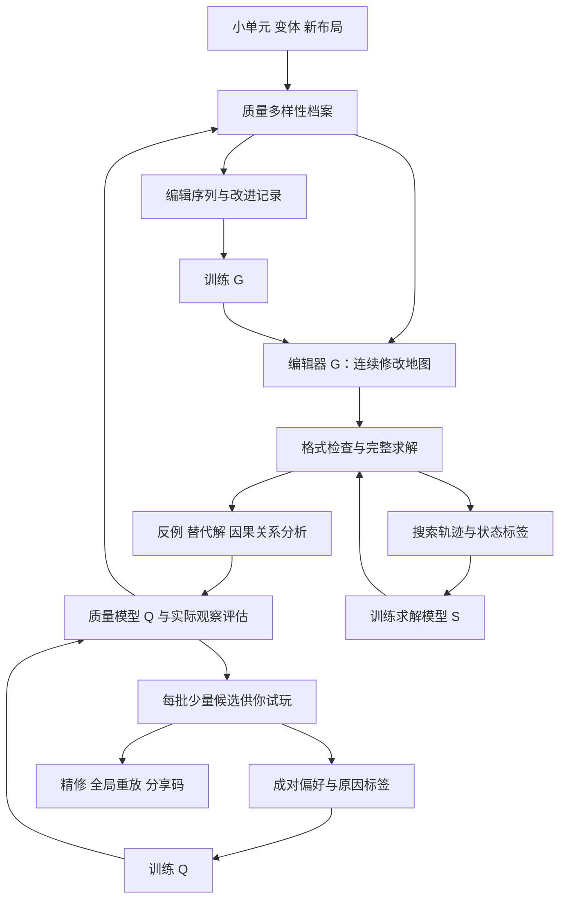

# 鬼迷宫 AI 训练方案：从小单元的因果关系到高质量地图

> 2026-10-11：本文保留原阶段方案／研究背景，训练尚未开始。当前规则、分享、编辑器和回放升级已经完成，以[交付记录](architecture-delivery-20261011.md)和[当前分享协议](share-codes.md)为准；旧体力、旧码及旧独立回放描述不能作为当前使用入口。

日期：2026-09-22。规则基线：`9825376f2cf93f844146c83214f680425c22498b`。

依据：[调研报告](D:/Code/Program/Projects/ghost-maze/docs/ai-puzzle-generation-research.md)、[两个已验证的小单元](D:/Code/Program/Projects/ghost-maze/docs/puzzle-units/README.md)。

已明确的条件：个人工作站或少量租用 GPU；允许长期训练与长时间生成；优先死亡循环中的智力体验；你愿意定期试玩少量候选并做成对比较。仓库组织建议采用独立 AI 训练仓库，通过固定版本依赖复用游戏规则。

本文确定一条可实施的主线，涵盖数据、网络、损失、奖励、课程与验收。模型规模、超参数、比例及数量都是建议起点，尚未通过训练验证。本次交付是方案，没有启动训练或创建线上评估服务。

## 1. 方案决策

采用 **质量多样性搜索 + 学习型地图编辑器 + 完整状态求解 + 人类偏好学习**。

先训练系统设计小单元，再训练单元间的关系，最后处理整张地图的组织与探索体验。最终生成时继续进行长时间搜索、验证和精修，交付少量精品。

系统学习三个主要能力：

| 能力 | 具体学习对象 | 学习结果怎样改善地图 |
| --- | --- | --- |
| 求解 `Sθ` | 在动态局面中优先尝试哪些行动 | 能验证更多候选与更复杂的新设计 |
| 设计评价 `Qφ` | 你在相近目标下更喜欢哪张题，以及为什么 | 把生成方向拉向精妙、公平和简洁 |
| 地图编辑 `Gψ` | 连续做哪些结构修改能改善一张题 | 提高有价值候选的比例，学习跨多次修改的设计关系 |

外层搜索维持多种设计；验证器提供可执行证据；你的反馈负责校准机器指标没有捕捉到的价值。

这套方案分别借鉴 [MAP-Elites](https://arxiv.org/abs/1504.04909) 的多样化档案、[PCGRL](https://arxiv.org/abs/2001.09212) 的编辑决策、[Expert Iteration](https://arxiv.org/abs/1705.08439) 的搜索与学习交替，以及[人类偏好奖励学习](https://arxiv.org/abs/1706.03741)。这里的组合与具体配置是针对本游戏的工程设计，不能把论文结果当成本项目的效果保证。

## 2. 把“高质量”变成系统能学习的东西

### 2.1 最终目标

对指定熟练度和风格，找到满足以下条件的地图：

1. 有一条真实玩家可以执行的无伤解，且满足体力约束。
2. 玩家需要理解某种有价值的关系，而非主要依靠无差别穷举。
3. 理解以后，执行相对清楚，没有大量无意义重复。
4. 关键关系可被观察、推断或通过有信息的失败学会。
5. 相比已有题，它提供新的关系或新的应用方式。

第一项由引擎验证；后四项使用可检查的代理指标与你的评价共同判断。难度设为条件和区间，不作为无限增长的奖励。

### 2.2 两个小单元怎样变成训练材料

| 材料 | 已有机器证据 | 可训练的判断 |
| --- | --- | --- |
| 单元一：探头再绕行 | 最短 10 次动作；禁止探头后无解 | 玩家返回原位置时，鬼的布局改变，后续路线因此可用 |
| 单元一加 A 门，终点不变 | 原 10 步解仍成立，完全不用按钮 | 出现机关不等于机关对解法有必要性 |
| 单元二：移动终点并设置 A 门 | 最短 13 次动作；不关门无解 | 同一扇门的作用依赖目标位置和返回路线 |
| 去掉鬼的版本 | 两题分别可用 6 和 4 次动作直接通过 | 鬼确实改变了需要解决的问题 |

这些证据可以直接用来训练“机制作用”和“修改效果”的预测。**它们不能自动变成你对地图的偏好标签。**你对两个单元的肯定，也不能被擅自解释成“第二题比第一题更好”。

每次设计都尽量形成一个小组：原版、改进候选、冗余版、捷径版、不可解版，以及各自的证书或反例。学习目标是理解这些差别。

### 2.3 先定义单元的输入和输出

一个单元的数据至少包括：局部地形、入口条件、出口条件、期间需要改变的状态、代表性解法、错误策略、可能受外部影响的关系。

例如单元一在移除试玩终点后，玩家出口是 `(6,2)`，鬼在 `(4,2)`；它输出的是仍有追逐压力的局面。单元二输出玩家 `(3,1)`、鬼 `(2,2)`、A 门关闭的局面。二者会给后续题不同的条件。

单元库保存这些状态关系及其适用条件。地图拼接后仍须重新全局求解，因为新路径会改变鬼的 BFS，新视线和同字母按钮也会改变行为。局部证书不能直接证明组合后的地图成立。

## 3. 系统架构



| 组件 | V1 的具体实现选择 | 是否需要训练 |
| --- | --- | --- |
| 权威环境 | 当前 JS 引擎，封装合法动作和观察 | 否 |
| 完整求解器 | 小单元 BFS/A*；大题用学习指导的搜索找解，再独立验证 | 搜索算法本身不训练，动作排序与代价预测训练 |
| 因果分析器 | 从轨迹提出事件假设，再受约束求解查反例 | V1 规则提取，后期增加表示学习 |
| 质量模型 `Qφ` | 初期正则化成对排序；数据增长后再升级空间与事件编码 | 是，核心监督来自你 |
| 地图编辑器 `Gψ` | 图编码器 + 分解动作解码器；监督预训练后做 PPO | 是 |
| 档案与调度 | MAP-Elites 式多样性档案、候选去重与验证预算分配 | V1 不需要神经网络 |
| 玩家观察评估 | 当前渲染可见信息 + 几类有限规划策略 | V1 只作诊断；足够真人轨迹后再学行为模型 |

三个主要模型分开保存参数与版本。`Qφ` 是地图质量模型；PPO 里预测编辑收益的 value head 是训练辅助，两者不能混为一谈。

## 4. 状态表示与网络结构

### 4.1 完整状态与真实观察分开

求解状态包含玩家位置及楼层、各层有序鬼位置、已拾取物品、钥匙数、已消失数字门、字母门状态、剩余体力和终止标志。静态地图单独保存。

动作仅开放四方向及使用楼梯。按钮通过“站在按钮位置朝正确方向行动”触发；不开放任意 `PRESS_BUTTON(letter)`，也不开放任意位移、复活或修改状态作为无伤解动作。

成功动作数 `T` 包含按钮；移动与上下楼次数 `L` 对应体力消耗。验证要求整条轨迹合法、无伤且在体力内，优化时分别记录 `T` 和 `L`。

用于物理规划的状态可以省略动画时间戳、轨迹和不影响动作能力的探索记录。用于首次探索的代理必须保留可见性与观察历史，而且只能读取真实可显示的信息；`computeGameView` 返回的全量引用不能直接当作它的观察输入。

### 4.2 采用带边属性的关系图

V1 选用图表示，因为墙位于格子之间，字母组和楼梯还存在远程联系。

| 对象 | 表示的特征 |
| --- | --- |
| 格子节点 | 坐标、楼层、是否活动、起终点、物品、当前玩家、观察标记 |
| 邻接边 | 方向、原始墙类型、当前墙类型、数字门门槛、单向方向、门初态与当前态 |
| 鬼节点 | 位置、所在层、同格鬼数，连接所在格子 |
| 字母组节点 | 连接同字母门与按钮，编码共享翻转关系 |
| 楼梯关系 | 连接配对位置，保留方向和特殊动作类型 |
| 全局节点 | 钥匙、体力、目标风格、阶段和其他全局条件 |

固定画布中的非活动格也保留为带标记的节点，便于编辑器添加格子。墙边可通过边消息传递编码；按钮还需保存附着格与朝向。

坐标和方向不能全部抹去：鬼的等距寻路有上、右、下、左的顺序。2026-10-12 起，鬼争位不依赖数组顺序或编号；物理模型按位置和同格数量表示。旧的具名研究监控另存身份，不作为玩家隐藏规则。字母名称可以规范重命名，但必须保持共享关系与各门初态。

### 4.3 V1 网络配置

| 网络 | 建议结构 | 输出 |
| --- | --- | --- |
| `Sθ` 求解模型 | 6 层带边属性的残差消息传递，隐藏维 128；字母组与全局节点参与通信 | 5 个动作的策略、剩余动作代价、可达性辅助头 |
| `Gψ` 编辑模型 | 同类图编码器，隐藏维 128；另加目标与编辑历史编码 | 操作类型、位置、参数、停止动作；编辑收益 value head |
| `Qφ` 质量模型初版 | 约数十项地图、解法、反事实特征；正则化 Bradley–Terry 排序模型，5 个重采样版本 | 相对偏好、模型间分歧 |
| `Qφ` 后续版 | 图编码器 + 2 层、隐藏维 128 的事件序列 Transformer + 结构特征 | 条件偏好分，辅助原因预测 |

`Sθ`、`Gψ` 以数百万参数以内至数百万参数的容量为初始实验范围，实际数量以实现后统计为准。不会仅因参数更多就升级。第一版保持三个模型独立；后续可以试验编码器初始化迁移，避免同时共享更新造成互相干扰。

质量模型升级取决于新家族上的预测是否改善，不以“收集到某个数字就必须换大模型”为依据。只有几十到几百组偏好时，简单模型更容易发现错误特征。

## 5. 高质量评价如何落地

### 5.1 硬条件与审美评价分开

正式候选先满足：数据合法、证书可重放、真实动作可执行、模式与资源正确。存在物理解只是第一道条件。

接着记录机制是否起作用、是否有绕过核心的捷径、解法是否冗长、关键信息是否可观察、是否与已有题重复。最后由你的比较校准“巧妙程度、公平性、趣味和简洁”的取舍。

以下是拟采用的指标集，供后续实现评估器时使用；目前还没有部署这些新评估器。指标按可观察证据定义，参考 [Choosing what to evaluate](https://langfuse.com/academy/evaluate/choosing-what-to-evaluate)。

| 优先级 | 状态 | 指标 | 证据来源 | 影响的决策 | 可测量性 |
| --- | --- | --- | --- | --- | --- |
| P0 | 两个单元已有，待通用化 | 无伤可解与分享码重放 | 原引擎完整轨迹 | 是否进入正式候选 | 给出证书或未知状态 |
| P0 | 已有基本记录，待通用化 | `T`、`L` 与资源 | 动作日志 | 是否符合目标成本 | 可精确计算 |
| P1 | 两个单元已有，待自动化 | 核心事件必要性与替代解 | 受约束搜索 | 机关是否真正影响策略 | 证明、反例或未知 |
| P1 | 新 | 你的成对偏好 | 实际试玩 | 学习质量方向与最终排序 | 人工标签，不伪装成物理真值 |
| P1 | 新 | 猜测、不公平和重复反馈 | 原因标签与观察轨迹 | 淘汰或调整候选 | 人工为主、自动诊断辅助 |
| P2 | 新 | 理解后重跑与概念迁移 | 试玩、提示与新布局 | 区分理解和记路线 | 样本充分后检验 |
| P2 | 新 | 行为新颖性与家族覆盖 | 事件关系、档案距离 | 保持设计多样性 | 代理指标，需抽查 |
| P2 | 新 | 每小时及每批试玩的精品产量 | 验证、计算、人工选择记录 | 是否值得延长训练与生成 | 可统计，依赖事先约定的接受标准 |

### 5.2 自动发现“这个机关有没有用”

从成功轨迹提取候选事件，例如：鬼穿过某条边、玩家返回相同位置但鬼已换位、切门后可行策略改变、开数字门释放新的鬼路径。

对候选事件运行两类检查：

1. **原地图上的限制搜索。**禁止该事件，寻找其他解；找到就是反例，完整穷尽才可证明必要性。
2. **地图对照。**删掉机关、改变目标、改变门初态，再重新求解，比较策略和解长。

地图删改会改变问题本身，只能辅助说明作用；证明原题中某操作必需，应依靠第一类检查。若检查“必须先 A 后 B”等历史关系，状态去重必须同时保存监测该关系的自动机状态，不能把不同事件历史误合并。

大型地图验证不完时，记录预算和结论范围。一个“80 次动作内没有替代解”的结论不能写成“所有解都必需”。

### 5.3 让模型判断关系，而非夸奖复杂度

质量特征包括四组：地图结构，代表性解法及策略族，反事实证据，实际观察下的试玩信息。门数、面积、解长只是背景变量，不能直接充当主要奖励。

对称或近似布局的好坏对照，有助于减少外观捷径；在不同面积、难度与机制中均匀采样，可以减少模型只偏爱某一种外形的倾向。生成器写的设计说明不进入初次盲评，避免文案影响你的第一判断。

第一版的有限规划代理只提示可能的陷阱，例如“永远朝终点走”“有门就开”“完全回避鬼”。这些代理被难住，不直接增加人类质量分。

### 5.4 你的反馈怎样进入训练

每批建议提供 4 张已经验证、风格不同的小题。你各试玩一次后，做 3～5 组成对比较：A 更好、B 更好、相近，另可标记两张都不值得保留。原因可以只选“关键想法好、信息公平、重复多、只能猜”等短标签。

批次混合两张质量预测较高的题、一张罕见设计、一张模型意见分歧大的题；不是每批都让你玩低分或未验证候选。所有比例可随实际体验调整，不在这里设定自动通知或固定日程。

训练样本为 `(地图 A, 地图 B, 目标条件, 偏好, 原因, 置信程度)`。只看演示与亲自解题的评价分开标记；同一张图第二次玩也标记熟悉程度。

最初学到的是你的设计审美。若以后要声称适合更广泛玩家，需要再收集其他玩家数据，不能从单人反馈直接外推。

### 5.5 偏好模型的损失与不确定性

基础公式：`P(A 优于 B | c) = sigmoid(qφ(A,c) - qφ(B,c))`。`c` 是难度、风格等目标条件。

以交叉熵训练；平局用软标签 0.5，无法判断的比较不硬塞标签。“两张都差”另外作为接受度标签，不能仅靠相对排序表达。

保留 5 个按地图家族重采样训练的版本，使用分歧帮助选择下一批值得问你的题。正式排序可采用 `均值 − 1×模型间标准差` 的保守启发值，再裁剪到目标区间；它不是严格的置信下界，尤其不能保证覆盖分布外地图。

将分数转换成“相对固定参考题集的平均胜出概率”，便于跨批次比较。参考题不是隔离测试集，参考集和模型版本在一轮生成中固定。

## 6. 求解模型 `Sθ` 怎么训练

### 6.1 先把两个单元的验证器通用化

现有 [design.mjs](D:/Code/Program/Projects/ghost-maze/docs/puzzle-units/design.mjs) 只为两张固定单层图保存玩家、鬼和一扇门的状态。它不能直接拿来训练带钥匙、多门和楼梯的通用模型。

通用版以实际死亡循环语义求解，状态键包含全部相关动态字段。对到达相同物理布局但体力和已用动作不同的节点保留必要的非支配标签；不要因较早发现某位置就剪掉更有资源的路线。

小图先使用精确 BFS/A*。松弛距离场只能作便宜筛选或经过证明的下界。完整图穷尽后可以从胜利节点反向计算各状态的最小成功动作数和最佳动作集合。

### 6.2 训练数据和标签

每个样本是 `(map_id, 动态状态, 合法动作掩码, 标签, 证据等级)`。

| 证据 | 可用于训练的标签 | 不允许推断的标签 |
| --- | --- | --- |
| 完整搜索得到精确最优 | 最佳动作集合、精确剩余代价 | 不自动说明对人有趣 |
| 找到并重放成功的解 | 可行行动示范、代价上界、可达为真 | 不能把路径长度当作精确最优 |
| 已证明无解或死亡终态 | 可达为假 | 不把高难但超时的状态混入 |
| 预算耗尽 | 搜索预算、已知下界、未知标记 | 不标成不可解或失败策略 |

地图静态数据按 `map_id` 复用，训练样本仅保存紧凑动态状态；不用为每个动作重复存整张墙数组和动画轨迹。

### 6.3 损失函数

对完整搜索样本，令 `A*(s)` 为所有最优动作，策略头可以使用：

`Lπ = −log Σ[a 属于 A*(s)] πθ(a | s)`。

这样不会把另一个同样最优的动作错当成错误。只有一条可行示范时，做加权行为克隆，明确标记其非最优来源，并保持与精确样本的采样平衡。

距离头预测 `log(1 + 剩余成功动作数)`。精确样本用 Huber 损失；仅有上下界的样本使用区间损失：预测落在已知区间之外才受罚，没有有限上界的一侧不施加上界惩罚。

可达性辅助头只对有证据的真/假标签使用二元交叉熵。初始组合可为：`LS = Lπ + 0.5 Ldistance + 0.2 Lreachable`，再按梯度量级和验证结果调整。

合法动作掩码只屏蔽不能产生合法操作的选择。一个会导致被鬼抓到的移动仍可能是合法动作，不能为了让训练成绩好看而把所有危险动作隐藏掉。[动作掩码研究](https://arxiv.org/abs/2006.14171)

### 6.4 搜索与学习交替

1. 用精确搜索解一批小题，训练第一版策略。
2. 用当前策略和代价预测给更大题的候选节点排序，找到新解。
3. 原引擎重放新解；对有希望的题追加精确搜索，改善证书。
4. 新旧题混合训练下一版，防止遗忘。
5. 在未参与训练的家族上，比较真实找解时间、展开量与成功率。

这是搜索教网络、网络再帮助搜索的路线，受 [Expert Iteration](https://arxiv.org/abs/1705.08439) 启发。网络代价预测用于发现阶段的 best-first 搜索，不被视为可采纳下界；“最优”和“无解”的声明由具有正确下界或穷尽性的独立搜索给出。

同一批比较保持时间或节点预算一致。既看展开量，也看墙钟时间：逐节点调用 GPU 可能抵消节省的搜索，因此后期再做批量推理、静态图缓存与 CPU/GPU 调度。

## 7. 地图编辑器 `Gψ` 怎么训练

### 7.1 把设计过程建模为一个短回合

编辑状态为 `(当前地图, 目标条件 c, 剩余编辑次数, 已有验证反馈)`。一次编辑回合从档案父图或新布局开始，连续修改若干次，结束后评价最终地图。

`c` 包括允许的机制、有效区域范围、目标难度、预计执行成本、单元或组合阶段。可以指定某个设计主题，也必须有不指定主题的探索回合，给未命名的新关系留位置。

V1 每回合最多 8 次编辑，结构复杂后试验 16 次。允许中间地图暂时无解或质量下降；只要数据结构仍合法，就可以继续修改。最终地图才必须通过交付条件。

这使“先加一扇暂时多余的门，再移动终点使其有意义”可以被完整探索。严格逐步变好的贪心修改会丢掉这类轨迹。

### 7.2 编辑动作及解码方式

| 编辑类型 | 参数 | 意义 |
| --- | --- | --- |
| 设置一条墙边 | 层、边位置、墙类、相应参数 | 改变通路或视线 |
| 改变活动格 | 层、格子、开关 | 扩展或收缩有效形状；必要的边界更新由构造器执行 |
| 增删或移动实体 | 实体类型、来源、目的格 | 改变鬼、钥匙、起终点与路线的关系 |
| 设置按钮或门组 | 附着位置、方向、字母组、门初态 | 构造联合翻转与操作次序 |
| 调整小片段 | 片段、位置、方向、边界连接 | 进行多个关联的低层修改 |
| 组合单元，后期开放 | 两个单元、入口出口、共享状态关系 | 学习跨单元联系 |
| 停止 | 无 | 提交当前候选；至少完成一次真实编辑后开放 |

解码按 `操作类型 → 对象/位置 → 参数` 分解，避免把全部可能操作平铺成巨大动作表。各条件分布都有自己的结构合法性掩码，例如不能把按钮放在不存在的附着边上，不能把初始鬼放到出生点。

掩码不提前要求每一步都有解，否则无法经过必要的中间结构。第一版也不开放修改游戏规则、评价器、游戏模式或降低初始体力来制造难度的动作。

### 7.3 第一步：从搜索得到的编辑序列做监督训练

在外层变异搜索中记录完整父子链，而不只保存最终好图。对通过验证、符合目标且有质量证据的改进序列，训练：

`LG-SFT = −Σ w_i log Pψ(编辑序列_i | 父图_i, 目标_i)`。

权重按证据可靠性与家族平衡设置并截断，避免某一个容易量产的机制主导训练。只由自动代理分数选中的样本要保留其来源，不能伪装成人工认可。

负面或中性的编辑也保存，用于训练修改效果预测和质量模型。例如“加门后仍有不按按钮的最优解”，是非常有用的中性对照。

### 7.4 第二步：用固定评价器进行 PPO 微调

监督预训练让编辑器能提出基本合法、常有意义的修改。质量模型在保留数据上表现可靠后，再用 PPO 优化完整编辑回合的结果。[PPO](https://arxiv.org/abs/1707.06347)

对目标 `c`，第一轮可使用下列透明的归一化指标：

| 符号 | 定义 |
| --- | --- |
| `H` | 你的偏好模型相对参考题的保守质量估计；另检查接受度预测 |
| `C` | 被验证的关键状态关系对目标的符合程度；同义事件与复制单元不重复计分 |
| `N` | 相对冻结档案的行为新颖性；以策略关系和事件结构为主 |
| `J` | 超出目标执行成本的程度，以及可删除而不影响核心关系的冗余；范围限制在 0～1 |

为使第一版可计算，`C` 可先用分档规则：已验证一个必要状态关系、已验证两个操作的先后依赖、以及尚无足够证据。按目标是单一作用还是组合关系映射到 0～1，并保留未知标记；不能把每一个必经格都当成新思想。`N` 使用规范化事件特征的近邻距离，尺度在一轮开始时冻结。`J` 分别记录当前最好证书超出目标动作区间的程度与已验证的冗余机制比例；没有证明最优时，它评价的是当前可交付解法的成本，不能据此断言地图不存在短解。这些都是可替换的代理指标。

对已证实可解的地图，建议起始分数为：

`F(m,c) = 0.05 + 0.95 × clip(0.80 H + 0.15 C + 0.05 N − 0.10 J, 0, 1)`。

其余地图的**当前可交付评分**为 0。已证明无解和验证超时仍分别记录；0 在这里表示尚不能获得可交付收益，不表示二者的真实可解性相同。

一次编辑回合的终局奖励：

`R = F(子图,c) − F(父图,c) − 0.005 × 实际编辑次数`。

中间动作奖励为 0，终局一次性给出地图改进收益并扣除上述编辑成本；折扣 `γ=1`，不因需要多步铺垫就额外折损最终价值。每个回合有固定最大编辑长度。

这里的权重只是起始假设：偏好占主要部分，必要关系辅助，新颖性占小部分。必须做去掉 `C`、去掉 `N`、改变 `J` 的对照，检查它们是否真的改善你的偏好，而不是把这些数字视为“好玩公式”。

`H` 尚未校准时，不以这套分数宣称正在优化人类乐趣。此时依靠搜索、结构证据和你的直接选择积累资料，编辑器主要做监督训练。

### 7.5 PPO 数据边界与版本要求

父图可以从旧档案抽样，但 PPO 的动作轨迹由当前策略生成，并保存旧策略概率、每一级掩码、目标条件和终局评价。随机变异器、人工编辑和旧策略数据用于监督或分析，不未经校正就混入当前 PPO 更新。

一轮 rollout 与更新期间，冻结求解预算、质量模型、参考题集、行为特征和新颖性档案快照。否则相同编辑会因为评价器移动而得到难以解释的奖励。

使用终局奖励时，不把每一步“变好”设为入场条件。档案也要保留一定比例的新颖但质量未定的候选；它们能成为后续多步改进的起点。

## 8. 冷启动、数据集与课程

### 8.1 从两个单元扩展，但不把两题当作全部世界

起点是已有两题、冗余门对照和去鬼对照。随后通过手工设计与结构搜索，扩充至约 20～40 个微型案例，覆盖若干不同家族：拐角诱导、便于观察的玻璃、互补门、延迟开门、单向返回、资源与路线等。

第一轮先使用单层、8×8 画布、约 12～30 个活动格、0～2 只鬼和少量机关。先保持 100 体力，避免把紧缩资源当作主要难度来源。网络与数据格式从一开始保留其他机制的字段，课程逐步开放动作。

训练数据必须包含三种变化：同思想不同布局；同布局不同思想；外观与思想都新的候选。只大量拉伸两个环路，会得到会画环路的模型。

### 8.2 四套独立数据

| 数据集 | 主要字段 | 更新来源 |
| --- | --- | --- |
| 求解数据 `Dsolve` | 地图、状态、示范动作、代价界限、可达证据、搜索预算 | 搜索与独立验证 |
| 编辑数据 `Dedit` | 父图、目标、编辑序列、子图、评分版本、结果 | 所有提案方法的记录；训练时按来源区分 |
| 偏好数据 `Dpref` | 两张图、条件、偏好、原因、熟悉度、评价方式 | 你的实际反馈 |
| 保留评估集 `Dholdout` | 固定家族、不同机制组合、已知证书与人工参照 | 预先隔离，阶段结项使用 |

轨迹、反事实和人工标签分开保存。缺失偏好为缺失值，不能用生成器说明或求解器高分补成人工标签。

建议一个候选记录的结构如下；这是字段设计示例，尚未写入训练数据：

```json
{
  "map_id": "地图内容哈希",
  "family_id": "生成家族标识",
  "parents": [],
  "ruleset": "规则版本",
  "condition": {"stage": "unit", "difficulty": "intro"},
  "verification": {
    "status": "solved",
    "optimality": "proven",
    "actions": "UDDRRRRUUR",
    "total_actions": 10,
    "movement_cost": 10
  },
  "counterfactuals": [
    {"restriction": "禁止进入探头格", "status": "proven_unsat"}
  ],
  "human_preference_ids": [],
  "evaluator_version": "评价器版本"
}
```

该示例的动作与代价来自第一题，其他标识是说明性占位。通用反事实还需保存精确定义的谓词、搜索范围与是否穷尽。

### 8.3 课程按关系深度推进

| 阶段 | 主要任务 | 进入下一阶段的条件 |
| --- | --- | --- |
| A：单一作用 | 诱导、隔断、取得资格、改变一条通路 | 能稳定产生你认可的小题，且作用有证据 |
| B：单元内部组合 | 先诱导再关门、先安排路线再开数字门 | 顺序与互相依赖得到验证，不只是多放机关 |
| C：两个单元的联系 | 共享鬼、共享开关、前题出口状态影响后题 | 全局解成立，打断联系后策略确实变化 |
| D：整图组织 | 教学、变形应用、组合挑战，安排观察与返回 | 完整体验好，单元拼接没有产生捷径或无聊搬运 |
| E：更自由探索 | 新机制组合、多鬼、多层、新抽象 | 维持可靠验证、人类质量与多样性 |

每轮保留旧题和低复杂度题。课程只控制采样分布，不规定所有新地图必须依照同一套模板。可借鉴 [ACCEL](https://arxiv.org/abs/2203.01302) 的渐进编辑思想，但用于代理学习的难题不自动进入精品库。

### 8.4 数据划分与去重

按家族和祖先来源划分训练、开发、测试；同一个单元的拉伸、镜像、旋转和近亲变体不跨集合。由保留单元组合出的地图也保留，不能从另一条生成路径混回训练。

最早只有两个家族时，只能做原型和回归，不能声称跨机制泛化。扩充家族后，再做保留新家族与新组合的评估。

旋转、镜像与鬼重排不是无条件语义对称，全部重新验证。档案既做内容去重，也做策略关系去重；同一思想的变体仍可保留少量，用于检验迁移和可控性。

## 9. 单元组合和新思想怎样产生

### 9.1 两层编辑，分阶段训练

第一层编辑器在格子、墙、鬼和门上工作，负责产生与精修小单元。第二层在已有单元及其状态条件上工作，选择入口出口、改变目标、建立共享机关或共享鬼的关系。第二层选择后，仍调用第一层编辑器调整几何，并全局重新验证。

V1 只实现第一层。单元库和质量数据足够后，再给同类编码器加入“单元节点、入口条件、出口效果、读写的机关组”等特征，训练组合操作。无需第一天同时训练所有模块。

组合时，至少搜索三种联系：前一个单元改变鬼的位置，成为后一个单元的条件；前一个单元切换机关，同时改变后一个单元的路线；玩家必须带着后续目标来决定前一个单元的完成方式。

顺次拼接可以作为基线，不能仅因总长度增加就算质量提高。应比较有联系的版本和切断联系的对照，检查策略是否真的变了，再问你这种联系是否有趣。

### 9.2 档案保留不同的好设计

采用 MAP-Elites 式档案，初期每个视角只使用少数维度，例如主要关系、依赖深度、有效区域规模。另留一个按实际事件表示聚类的开放档案，容纳尚不能归入已有机制标签的候选。

每个格子保留 2～3 个具有不同长处的候选，避免一个微小高分优势排除全部其他方案。面积、机关数和解长进入描述或目标条件，不作为主要质量值。

提案器未训练时，可用约 70% 低层变异、20% 小片段重组、10% 新布局。训练后可试验 50% 学习编辑器、30% 低层变异、20% 新布局与片段重组。比例是实验设置，保留独立于模型的提案来源是主要原则。

### 9.3 模板是起点，不能成为全部动作空间

即使已经学会“引开再关门”，生成器仍可编辑每条墙、每个实体和机关关系。提出新地图不需要先选一个已有谜题模板。

新的好题经验证后，可以提炼成一个参数化单元或构造操作；提炼出的操作必须在多个不同布局上成立，不能只把某张偶然成功的图换个名称收藏起来。

对没有可靠标签的新关系，先保留完整轨迹和未知标记，增加验证预算或送到下一批人工评审。不能因为质量模型低置信，就把所有陌生设计都过滤掉。

### 9.4 大语言模型的可选位置

V1 的必要组件都是当前规则、搜索和小模型。大语言模型可作为低频提案来源：构思新关系、编写受限构造操作、整理已经验证的反例和反馈。它生成的说明不作为证书，也不自动成为质量标签。

它只能生成地图数据或受限编辑，不能修改引擎、胜负规则和评价器。是否引入、是否微调，以增加的精品产量相对于调用或训练成本来决定。

## 10. 一轮完整训练的执行步骤

### 10.1 启动阶段

| 顺序 | 具体工作 | 产物 | 建议规模与退出条件 |
| --- | --- | --- | --- |
| 0 | 固定规则、通用状态键、动作与观察接口 | 参考环境与重放器 | 现有案例及规则边界一致；没有非法操作产生的伪解 |
| 1 | 扩充微型案例，生成同思想与反例变体 | 种子、对照、家族划分 | 约 20～40 个案例；先出现数百张有证据的变体 |
| 2 | 精确搜索并训练 `Sθ` | 解法数据与求解模型 | 先约 1,000 张可解小图或等价覆盖；用保留家族验证提效 |
| 3 | 外层变异搜索与你的小批试玩并行 | 候选档案、偏好数据 | 少量标签即可拟合诊断版；积累约 100～300 组有效比较检验可靠性 |
| 4 | 用搜索编辑链训练 `Gψ` | 可用的编辑策略 | 从已有可靠记录起步，逐渐积累数千条编辑链 |
| 5 | 固定可靠 `Qφ`，运行 PPO 与档案搜索 | 改进的候选与策略 | 在相同预算下胜过不训练编辑器的基线 |
| 6 | 扩展到相互联系的单元与整图 | 组合数据和全局证书 | 独立试玩偏好支持升级，而非单看自动分数 |

这些规模不是硬性门槛。第一批好题可以在模型训练完成前就出现；不必等收集几百组标签才开始给你有价值的候选。

### 10.2 稳态训练周期

```text
冻结本轮规则、求解器、质量模型、档案快照和目标条件

从档案及新布局抽样父图
用学习编辑器、独立变异器、片段重组分别产生候选
保存每种来源的完整编辑记录

对每个候选：
    检查数据结构，计算内容和家族标识
    做乐观可达性粗筛
    分级调用完整求解器
    找到解：原引擎重放，记录证书与代价界限
    证明无解：保存明确证据
    尚未解出：保存未知，必要时进入追加预算队列

对已验证候选：
    提取事件，检查核心关系与替代解
    计算实际观察下的诊断特征
    评价质量与行为新颖性，更新本轮候选档案

仅用当前 PPO 策略产生的轨迹完成本批策略更新
将其他来源的编辑链加入监督数据
累计新解后更新求解模型，并混入旧数据
收集一小批你的比较，更新质量模型并做保留验证

通过开发集比较后，冻结下一轮版本
阶段结束时才使用隔离测试集
```

PPO 每批有固定评价器；整个训练周期结束后才替换质量模型。旧地图的历史分数保留版本，不覆盖成一个无法追溯的最新数字。新质量模型上线时抽样重评旧档案。

### 10.3 三类预算

**提案预算**控制新起点与修改数量。**验证预算**控制单张图搜索、反事实与最优性检查。**人工预算**控制你需要试玩的数量。

建议初始验证阶梯使用约 `10^3 → 10^4 → 10^5` 次状态展开的档位；对优质或新颖候选再增加。实际耗时先在当前机器测量，不用节点数冒充秒数。无谓地给每张明显重复的图做最强证明会拖慢发现。

验证超时的候选保留在研究档案，不进入已保证可解的交付档案。因为主奖励优化的是“当前预算内可证实的质量”，它天然会偏爱较易验证的图；独立探索份额与追加预算队列用于缓解这一偏差，不能声称完全消除。

## 11. V1 的建议超参数与工程方式

### 11.1 可作为首次实验配置的数值

| 项目 | 起始设置 | 调整依据 |
| --- | --- | --- |
| 图编码器 | 6 层、隐藏维 128 | 保留家族上的搜索效率和候选质量 |
| `Sθ` 监督优化器 | AdamW，学习率 `3e-4`，梯度范数裁剪 1.0 | 验证损失、成功率与泛化差距 |
| `Sθ` 有效批量 | 128；按图规模分桶 | 显存、CPU 供数与梯度稳定性 |
| `Gψ` 监督学习率 | `1e-4` | 有效编辑率与条件符合度 |
| 编辑回合 | 最多 8 次；后续对照 16 次 | 多步设计收益与验证成本 |
| PPO 学习率与裁剪 | `1e-4`，clip 0.2 | KL 变化、策略退化与真实候选质量 |
| PPO 折扣与 GAE | `γ=1`，`λ=0.95` | 有限回合中的方差与稳定性 |
| PPO 每批 | 64 个回合，最多约 512 个编辑动作 | 终局验证耗时与训练稳定性 |
| PPO 每批更新 | 4 个 epoch，minibatch 64 | 避免在同一批过度更新 |
| 质量模型集成 | 5 个家族重采样模型 | 预测分歧是否有助于挑选反馈样本 |
| 提案来源 | 训练后 50% 学习、30% 低层、20% 新布局/重组 | 消融与多样性覆盖 |
| 独立种子 | 初步至少 3 个 | 结果方差；后续按需要扩大 |

没有预设“训练多少步一定成功”。固定阶段预算，选开发集表现最好的检查点，并看每单位计算是否仍有改善。所有这些设置在实施时写入版本化配置。

### 11.2 个人工作站上的运行方式

建议新建独立仓库 `ghost-maze-ai`，训练侧使用 Python + PyTorch；原 `ghost-maze` 继续保持现有前端依赖与 v3 协议。训练仓库用 Git submodule 引用原游戏的固定提交，通过长期运行的 Node 进程批量调用其中的 `src/core`，或先消费离线生成的数据文件。实施时锁定经过验证的训练依赖版本，此文不安装依赖、不创建仓库。

CPU 负责候选搜索与验证，GPU 负责批量推理和模型更新。单卡可以按阶段轮流训练 `Sθ`、`Qφ`、`Gψ`，不要求三者同时占用显存。先用已有硬件剖析，再决定是否租卡。

前期不把每次动作变成跨进程 HTTP 调用。采用批量任务与紧凑状态，静态地图和编码缓存复用。后期性能确实不足时，另做快引擎，并以原始 JS 的随机合法轨迹进行差分验证；最终分享码仍由原引擎重放。

以前测过的单进程引擎吞吐量只适合作为起点，不能据此推断完整搜索或训练收敛时间。保存每轮真实 CPU 时间、GPU 时间、节点数、可解候选数和人工分钟数。

### 11.3 两个仓库的职责与协作

| 原游戏仓库 `ghost-maze` | 新训练仓库 `ghost-maze-ai` |
| --- | --- |
| 游戏规则的权威 JS 实现 | 调用规则的 Node 桥接与数据转换 |
| 浏览器界面、编辑器、渲染 | 搜索、地图编辑策略、模型训练和评价 |
| 分享码编解码与协议 | 生成地图、分享码和解法证书 |
| 游戏回归测试 | 训练基准、人工偏好、实验配置与记录 |
| 游戏发布 | 模型、数据版本和实验复现 |

建议布局如下，尚未创建：

```text
ghost-maze-ai/
  vendor/ghost-maze/    固定提交的游戏仓库子模块
  bridge/              调用原引擎的 Node 适配层
  search/              求解、证书和反事实分析
  generation/          变异、编辑和质量多样性档案
  models/              模型结构及训练代码
  evaluation/          偏好、保留测试与试玩记录接口
  configs/             可复现的实验设置
  data/seeds/          小规模可追溯种子
  data/manifests/      大数据的版本与位置清单
  runs/                本地实验输出，不纳入普通 Git 提交
```

子模块的目的是锁定权威规则，避免复制一份核心文件后各自演变。快速模拟器若确有必要，可以在训练仓库另行实现，但必须和固定版本的原引擎进行差分验证；最终地图仍由原引擎重放。

每个模型、数据批次和证书记住游戏提交、协议版本、训练提交、配置与种子。游戏规则升级后，训练仓库显式更新子模块，再重跑规则案例、代表性旧地图和证书，决定哪些数据需要重新求解。旧实验仍能保留原规则版本复现。

权重、海量轨迹和缓存保存在被忽略的本地目录或独立制品存储；Git 保存源码、配置、小种子与清单。第一版不需要为了这一点先搭建复杂云平台。

当前两个单元与调研文件尚未进入游戏提交。将来建仓时，应显式导入选定种子和文档；固定提交的子模块不会自动带入原工作区未提交的文件。本轮方案先保存在当前游戏仓库的 `docs`，未进行移动或提交。

### 11.4 建议的软件接口

```text
环境：reset(map, mode, resources) → state
环境：step(state, cardinal_or_stair_action) → next_state
观察：observe(map, state, history) → 实际可见信息
求解：solve(map, constraints, budget) → 证书 / 无解证据 / 未知
验证：replay(decoded_map, certificate) → 逐步一致性与胜负
分析：analyze(map, certificates, budget) → 事件、替代解、证据范围
编辑：propose(parent, condition, budget) → 编辑序列与子图
评价：rank(candidate, condition, evaluator_version) → 分数与不确定性
```

这些是拟实现的接口，不是当前已经存在的文件或服务。先做最少的本地模块即可，不需要搭建分布式平台。

## 12. 一张高质量地图最终如何生成

输入一个设计条件，例如：单层小题、约 20～40 个活动格、允许鬼和字母门、需要一到两个关键认识、理解后执行简洁。条件只限定目标范围，不预先写死解法。

1. 从不同档案和新起点启动多个搜索支系。
2. 编辑器提出多步修改，独立变异与重组同时提供候选。
3. 逐级求解与反事实分析，将预算集中到有希望且不同的候选。
4. 对候选做结构删减与观察位置调整，每次重新求解，检查是否产生捷径。
5. 从不同家族中选少量题给你试玩，按反馈再修改。
6. 冻结地图，通过分享码编解码及原引擎完整重放，保存证书、提示和评价记录。

允许一张地图花数小时或数天，但时间应花在新的结构、替代解检查与精修上。不能把对同一冻结评价器重复刷分当作质量不断进步。

对同一组独立起点，比较 1、6、24、72 小时预算下的最佳候选和一组多样候选。若你的盲评不再改善，应调整目标、表示或提案方式；延长相同计算只是一个待验证的选项。

## 13. 怎样判断训练真的成功

### 13.1 四个必须比较的版本

| 版本 | 配置 | 要检验的贡献 |
| --- | --- | --- |
| B0 | 完整验证 + 非学习变异搜索 | 没有网络时的真实能力 |
| B1 | B0 + 学习指导求解 | 更快求解是否让同预算下发现更多好题 |
| B2 | B1 + 你的偏好模型 | 质量选择是否更接近你的判断 |
| B3 | B2 + 学习编辑器 | 训练生成策略是否优于把同样预算继续花在搜索上 |

同时报告训练成本、生成成本、候选筛选量和人工成本。允许慢生成的目标下，关注最终选出的最佳题与多样题集，但不能隐藏为了选出它们用了多少计算。

### 13.2 验收不依赖一个总分

求解模型要在新家族上减少真实找解成本，不能只提高训练动作准确率。质量模型要胜过简单规则或固定基线，并检查预测校准、平局和分歧。编辑模型要在同等预算下带来你更愿意保留的题，不能只提升合法地图比例。

你的保留比较尽量隐藏生成来源和设计说明，随机化呈现顺序。统计按地图家族处理相关性，展示样本量、不确定性和失败例子，不把同题十个变体当成十个独立发现。

阶段性验收建议使用三个判断：你是否更偏好新版本；核心设计是否确实影响可行策略；新题是否超出了训练家族的表面变形。具体发布阈值依据早期数据和错误代价确定，不能凭空设一个统一“好玩分及格线”。

### 13.3 关键失败模式与对应修正

| 现象 | 可能原因 | 优先修正 |
| --- | --- | --- |
| 机关很多但原路线仍能直通 | 学会了元素数量，没有学到作用 | 增加冗余机关对照和替代解分析 |
| 题越来越长，评价却不更好 | 解长或搜索量在奖励中占了过大权重 | 改成目标区间，增加删减版本比较 |
| 生成器专门难住当前求解网络 | 单一代理漏洞成为目标 | 用不同搜索方式与历史策略交叉验证 |
| 新图都像两个环路 | 训练来源与提案操作过窄 | 新家族、新布局份额和低层自由编辑 |
| 组合后机关失效或出现捷径 | 只检查了独立单元 | 加入真实出口状态与全局重新求解 |
| 机器分高，你觉得只能猜 | 观察模型、反馈或质量特征偏离体验 | 补足真实观察和不公平对照，不继续放大奖励 |
| 陌生候选全被淘汰 | 超时误标失败或保守评价过滤新颖性 | 保留未知、追加验证预算、主动人工检查 |
| PPO 没比随机编辑好 | 数据不足、奖励噪声或动作设计不合适 | 回到搜索基线与监督编辑，定位问题再继续 |

## 14. 下一步实施的最小闭环

第一轮实施建议只追求一个具体结果：**能自动产出一批机制成立、彼此有差别的小题，并能根据你的一批比较，让下一批更接近你的审美。**

为此，先交付通用小图验证器、事件与反例记录、低层编辑搜索、家族档案和小批试玩记录。随后训练求解模型与简单偏好模型，积累编辑数据，再引入 PPO。组合地图的模型放在单元阶段有成果之后。

这样每一阶段都有可玩的输出，也都有可检查的学习收益。第一版不以训练规模或地图尺寸作为成果；关键证据是：系统越来越能提出有作用的修改，越来越少把冗余和试错当作精妙，并持续产生你愿意保留的新设计。
